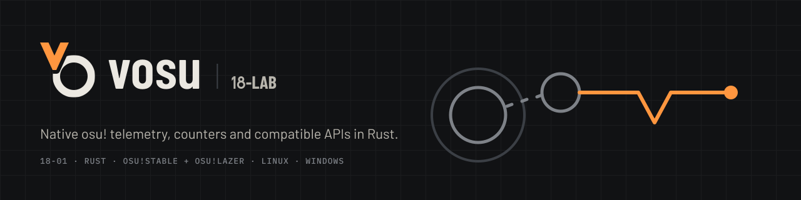

<div align="center">

<picture>
  <source media="(prefers-color-scheme: light)" srcset="assets/branding/vosu-banner-light.svg">
  
</picture>

<p>
  <a href="rust-toolchain.toml"></a>
  <a href="#platform-support"></a>
  <a href="#platform-support"></a>
  <a href="LICENSE"></a>
</p>

</div>

> A vibe-coded Rust implementation targeting API and behavioral compatibility with upstream [tosu](https://github.com/tosuapp/tosu), with native Linux implementation, measured hot paths, and a repository designed to work well with coding agents.

The daemon is implemented in Rust, with an embedded vanilla HTML, CSS, and JavaScript dashboard. Upstream tosu defines the compatibility target. Retained upstream material, the dashboard and calculator replacement history, and unresolved source-provenance questions are documented in [THIRD_PARTY_NOTICES.md](THIRD_PARTY_NOTICES.md) and the [provenance audit](docs/provenance-audit.md). Compatibility does not establish source independence or copyright ownership.

`vosu` reads live state from osu!stable and osu!lazer, then serves the dashboard,
counters, reports, and compatible HTTP/WebSocket APIs. It is one native daemon:
no Node.js, Electron, or separately installed .NET/C# runtime is required.

The daemon does not render in-game overlays. Use [vosulay](https://github.com/18-lab-dev/vosulay) separately or integrate it through its official 2.0 plugin and web editor. [ADR 0008](docs/decisions/0008-external-in-game-overlays.md) records the boundary.

## Why this build

| | |
| --- | --- |
| **Native runtime** | A single Rust daemon with embedded dashboard assets and offsets. |
| **Compatibility work** | gosuMemory v1, streamCompanion, and vosu v2 HTTP/WebSocket contracts have targeted checks and fixture evidence. Clean strict Windows stable/lazer captures and their exact source generations are recorded in [verification history](docs/testing/verification-history.md#10-release-gate-strict-windows-stable-2026-10-04). |
| **Linux support** | Native osu!lazer has a [clean strict live-parity capture](docs/testing/verification-history.md#10-release-gate-strict-native-linux-lazer-2026-10-04) at the recorded source/client pins. osu!stable through Wine is experimental and unverified, not verified release support. |
| **Measured performance** | Criterion covers memory scanning, snapshot reads, calculations, serialization, caching, and publication. Results and limits are recorded in the [benchmark guide](docs/testing/benchmarks.md). |
| **Agent-ready repository** | A pinned toolchain, explicit source ownership, runnable checks, architecture notes, and decision records keep automated changes reviewable. Start with [AGENTS.md](AGENTS.md). |

## Install

### 2.0 alpha builds

This branch builds the **2.0.0-alpha.2** application version; the published
plugin SDK has its own `1.0.0-alpha.N` version. `vosu --version` reports
`2.0.0-alpha.2`; the Windows file version is `2.0.0.0`. The stable 1.x
install below is separate. Alpha writes to its own `prerelease/` roots by
default and imports recognized 1.x settings once, read-only. It does not
import your overlays, plugins or credentials. Configure spare ports to run both
instances at once, and do not point alpha at a live 1.x overlay directory.
See the [2.0 migration guide](docs/migration/2.0.md) for paths, the stable
first-start migration, and changes to tools and overlays.

### Portable archive

The current release is **1.2.5**. Download `vosu-linux-v1.2.5.zip` or `vosu-windows-v1.2.5.zip` from the [v1.2.5 release](https://github.com/18-lab-dev/vosu/releases/tag/v1.2.5), then:

1. Extract the complete archive into a writable directory. Its root contains `vosu` or `vosu.exe`, plus `LICENSE`.
2. On Linux, restore the executable bit if your archive tool removed it: `chmod +x vosu`.
3. Run `./vosu` on Linux or `vosu.exe` on Windows.
4. Open <http://127.0.0.1:24051/>. By default, vosu opens the dashboard after startup. Overlay URLs stay on port **24050**, preserving their browser storage.

Do not run the Windows executable directly from an archive or a OneDrive-controlled directory. The updater cannot provide safe replacement and rollback in those locations. Windows executables are unsigned, so Windows SmartScreen may warn before the first launch.

### Linux packages

Download the package for your distribution from the matching
[GitHub release](https://github.com/18-lab-dev/vosu/releases):

```sh
# Debian 12+ / Ubuntu 22.04+
sudo apt install ./vosu_1.2.5_amd64.deb
# Fedora
sudo dnf install ./vosu-1.2.5-1.x86_64.rpm
# Arch Linux
sudo pacman -U vosu-1.2.5-1-x86_64.pkg.tar.zst
```

Arch users can build the source `vosu-git` package from the AUR once it is
published. The canonical recipe is
[`packaging/aur/PKGBUILD`](packaging/aur/PKGBUILD), which builds the current
`main` branch and needs the .NET 8 SDK at build time for the embedded offset
generator. For a local checkout:

```sh
cd packaging/aur
makepkg -si
```

Linux binaries require glibc **2.35 or newer** (Debian 12+, Ubuntu 22.04+,
current Fedora and Arch). Packages install the desktop launcher and icons,
and automatically grant process-reading capabilities on install and upgrade.
If the host refuses capabilities, installation still succeeds and prints a
hint to run `/usr/bin/vosu --setup` as your desktop user; it asks for
authentication itself. Never run the daemon itself as root.
Launch **vosu** from the application menu or run `vosu` as your desktop user.
Packaged installs do not use the [self-updater](#automatic-updates), and no
apt, dnf, or pacman repository is configured, so a system upgrade does not
pick up new versions. To upgrade, download the newer release package and
install it with the same command; the package manager replaces the old
version. AUR users update `vosu-git` with an AUR helper or by rebuilding it
from the current repository, which picks up the latest `main`. Start at login
remains an opt-in dashboard setting; packages do not ship or enable a systemd
service.

### Verifying downloads

Every release file from v1.0.1 on has a detached OpenPGP signature `<file>.sig`
made with sxlvia's release key, fingerprint
`6F0F 0D30 C09D 3A03 6246  A810 2CB6 524B B54B 2CDA`. The public key is
[`packaging/release-signing-key.asc`](packaging/release-signing-key.asc).

```sh
gpg --import packaging/release-signing-key.asc
gpg --verify vosu-linux-v1.0.1.zip.sig vosu-linux-v1.0.1.zip
```

Check that gpg reports a good signature from that fingerprint. Commits made
after v1.0.1, and later tags, are signed with the same key.

v1.0.2 is the exception: it was published before it could be signed, and the
repository's immutable releases don't accept files added afterwards. Verify its
downloads with GitHub's release attestation instead:

```sh
gh release verify-asset v1.0.2 vosu-linux-v1.0.2.zip --repo 18-lab-dev/vosu
```

### Manual per-user installation

Install into a user-writable location so vosu can update itself without running as root or Administrator. After extracting the release archive, run:

**Linux**

```sh
install -Dm755 vosu "$HOME/.local/bin/vosu"
install -Dm644 LICENSE "$HOME/.local/share/licenses/vosu/LICENSE"
"$HOME/.local/bin/vosu"
```

Add `$HOME/.local/bin` to `PATH` if you want to launch vosu as `vosu`.

**Windows (PowerShell)**

```powershell
$installDir = Join-Path $env:LOCALAPPDATA "Programs\vosu"
New-Item -ItemType Directory -Force $installDir | Out-Null
Copy-Item .\vosu.exe, .\LICENSE $installDir
& "$installDir\vosu.exe"
```

For a later manual upgrade, stop vosu, replace the executable and `LICENSE` with the files from the new complete archive, then restart it.

### Automatic updates

`ENABLE_AUTOUPDATE=true` follows stable `18-lab-dev/vosu` releases. The updater verifies the selected platform archive against its published SHA-256 digest, stages exactly one root executable, and uses a crash-recoverable helper and rollback flow.

`POST /api/runUpdates` starts the same update path from the same-origin dashboard. Set `ENABLE_AUTOUPDATE=false` or launch with `--update=false` to stop startup installation; `--update=true` enables it for one launch. Release builds still check GitHub for the latest release at every start so the dashboard can offer the update. The [privacy policy](PRIVACY.md) lists that and every other network request.

If the current user cannot write the executable's directory, vosu treats the install as externally managed on both Linux and Windows. Startup skips update checking and recovery, **Automatic updates** is disabled with an explanation, and `POST /api/runUpdates` returns the usual updater-error HTTP 200 JSON response: `{"error":"vosu is managed by your package manager; update it there"}`. Update these installs through their package manager instead.

A newer stable release whose major version is greater than the running build's (for example 1.x running against a published 2.0.0) is never installed automatically, by startup or by an ordinary `POST /api/runUpdates` request: it is only reported, as `{"status":"majorAvailable","version":"2.0.0","releaseUrl":"..."}`, with the version and a link to its release page. The dashboard shows it distinctly and only installs it after you tick a confirmation box; `POST /api/runUpdates` then needs `{"consent":true}` in its JSON body, otherwise it refuses with the same `majorAvailable` response instead of installing. Same-major updates are unaffected and need no consent field.

### Uninstall

Quit vosu from its tray icon first. On Linux, turn off **Settings → General → Start at login** if you enabled it; otherwise run `systemctl --user disable vosu.service` and delete `${XDG_CONFIG_HOME:-$HOME/.config}/systemd/user/vosu.service`.

- **Portable archive or manual per-user install:** delete the executable and `LICENSE`, or the whole directory you extracted. On Windows that directory also holds the configuration, overlays, settings, logs, and cache, so deleting it removes everything.
- **Linux packages:** `sudo apt remove vosu`, `sudo dnf remove vosu`, or `sudo pacman -R vosu`. Source AUR installs: `sudo pacman -R vosu-git`.
- **Linux user data:** packages and portable installs leave your data in place. Delete `${XDG_CONFIG_HOME:-$HOME/.config}/vosu`, `${XDG_DATA_HOME:-$HOME/.local/share}/vosu`, and `${XDG_CACHE_HOME:-$HOME/.cache}/vosu` to remove configuration, overlays, logs, and caches.

<!--
SignPath signing is hidden until SignPath Foundation approves the project; until
then every Windows release is unsigned. Restore this section once releases are
signed through SignPath.

## Code signing policy

Windows release executables are signed through SignPath once SignPath Foundation approves the project; until then they are unsigned, and each release's notes state which applies. Free code signing provided by [SignPath.io](https://about.signpath.io), certificate by [SignPath Foundation](https://signpath.org). The [code signing policy](CODE_SIGNING_POLICY.md) lists team roles, what is signed, and how each signing request is approved.
-->

## Privacy

vosu has no accounts, telemetry, or analytics. It contacts GitHub for update checks and downloads, and the tosu catalog and overlay download hosts when you browse or install community overlays. The [privacy policy](PRIVACY.md) details each request and the data kept on your computer. The [security and installation disclosure](docs/security.md) describes how vosu reads the game, the Linux capabilities it requests, and everything it installs or changes; report vulnerabilities as described in [SECURITY.md](SECURITY.md).

## Command-line options

The public command flags are standalone actions:

```text
-h, --help
-s, --setup
-V, --version
```

`vosu logs [-n N] [--follow]` prints the last N daemon log lines (default 50).
Use `--follow` for live output, and Ctrl-C to stop. It reads the current
installation/channel's log files directly, including after a crash.

`--help` prints usage and `--version` prints the version. Each public flag
action must be the executable's only argument; other arguments start the daemon.
On Linux, run `vosu --setup` as the normal desktop user to probe the compiled
process-event backends and install their capabilities. Setup requests
operating-system authentication when needed; do not run the ordinary daemon as
root.

Graphical launches run in the background with the system tray as their UI;
**Show logs** opens live logs in a terminal. Windows 11 24H2 and newer do not
create a console; older Windows may briefly flash one before detaching it.
Launching `vosu` from an existing terminal retains output, shell waiting,
exit codes and Ctrl-C. On Linux, **Show logs** uses `xdg-terminal-exec`,
`$TERMINAL`, or an installed common terminal; without one it opens the log
file in the default application.

Use repeatable `--tool <directory>` arguments to serve trusted development
web tools from their package directories. Manifest, settings and UI edits do
not require a daemon restart. Use `--plugin <directory>` to register a
development native plugin in debug or prerelease builds. A prerelease release
build accepts only `runtime = "process"` for a development plugin, and it
does not load until you approve the exact manifest and library in **Tools →
Plugins**. Changed bytes need a new approval. A process host is **not a
sandbox**. See the [tool protocol](docs/tools/protocol.md) and [plugin
authoring guide](docs/plugins/authoring.md).

On Linux, a process plugin can ask to create user namespaces for a
Chromium-style sandbox. The dashboard shows this opt-in before approval.
It does not sandbox the plugin itself or change Windows behavior.

Production startup requires the bundled `vosu.osu` plugin and its discovery
service. A missing plugin, load/create failure, or absent discovery service
stops startup rather than serving silently without game discovery. No running
osu! process is not an error: the first successful scan logs
`Initial process discovery completed: N osu! process candidate(s)` (including
zero). On attachment, `Found osu! process PID N (CLIENT); probing memory`
reports a candidate, not proof that capture is ready. Plugin startup errors are
reported as `Plugin startup failed: ...`. The daemon forwards all tracing
WARN/ERROR events, plus INFO from `vosu_*` targets, into its normal logs.

Offset resolution is automatic. For each discovered osu!lazer process, vosu first
checks a valid cache entry for that exact process version, then the matching
embedded offsets asset, and finally runs the embedded self-contained generator
against that exact PID and version. Generation is local and produces an offsets
blob; the daemon validates and atomically installs it in the normal offsets cache.
It never downloads offsets or scans a different process, and a failed generation
does not replace an existing cache entry.

End users do not install .NET, an SDK, a source checkout, or a runtime override.
The generator payload is embedded in release binaries and is extracted into the
plugin's data directory only when an exact process needs generation. A release
binary must contain its matching generator payload; a debug/development binary
without a prepared payload reports an explicit missing-bundle error rather than
falling back to a remote source.

Generation runs both managed helpers with the discovered client's bundled CLR
and framework files in a disposable working directory. This keeps measurement
on the same runtime as the game, including newer .NET versions and osu!'s CLR
fork. The verified embedded payload supplies the helper code; neither the game
installation nor the extracted payload is modified. Linux links the client
runtime files; Windows hard-links them when possible and copies them otherwise.

Offset caches now live in the bundled osu! plugin's data directory:

- Linux: `${XDG_DATA_HOME:-$HOME/.local/share}/vosu/plugins/vosu.osu/offsets`.
- Windows: `plugins\vosu.osu\offsets` under the portable executable directory.

vosu does not migrate the former platform-cache `offsets` directory. Existing
files stay untouched; when embedded offsets do not match, the first load of
each lazer version regenerates locally. The generator payload and scratch
workspace live in the sibling `offset-generator` directory. Prereleases use
the [prerelease data root](docs/migration/2.0.md#try-an-alpha-without-moving-1x-data).

Offset entries are keyed by client version and remain the validated
`<version>.json` contract. The separately extracted generator payload cache is
keyed by platform/runtime and embedded bundle checksum, so a helper from another
release build cannot be reused accidentally.

### API v1 state

Use [API v1](docs/v2/api-v1.md) for live session state, public resources and
selected-field WebSocket subscriptions. The common namespaces describe the
client, status, chart, play and skin; `vosu.osu` adds game-specific fields.
Select only what you display. Selecting `/vosu.osu/play/hitOffsets` or
`/vosu.osu/play/keyHitErrors` (or an overlapping selector) opts into that
collection; there is no separate API v1 precise socket or `ENABLE_*` gate.
API v1 serves file and tree references, never private paths. The
upstream-compatible `/json*` and WebSocket feeds are separate adapters.

## Tools

The dashboard's **Tools** page manages web tools and native plugins. **Available**
lists packages from your sources. Official [18-LAB tools](https://github.com/18-lab-dev/vosu-tools)
ship separately; vosu embeds none. A catalog v2 install plan shows each
package and dependency, its source, and any native runtime, trust, approval
or declared access to the osu! client's install paths. Read the plan and
confirm it once. Packages are fetched over HTTPS without source credentials,
checked against the catalog size and SHA-256, and committed together,
dependencies first. A successful install reports each package's load or
activation outcome separately. **Uninstall…** previews which unused
dependencies go with the package and refuses while another package needs
it. Removing an in-process plugin or untrusting its source requires a
vosu restart to take effect.

Catalog process plugins start in their own supervised hosts after install,
and again when vosu restarts. A plugin from an untrusted source needs
approval for the exact package in its install plan; changing the installed
manifest or library needs fresh review before those bytes can run. Use the
Tools page's **Plugins** section to review, revoke, stop, or restart one.
Updating or uninstalling a process plugin stops the old host first.

For in-game overlays, install the [native vosulay runtime](https://github.com/18-lab-dev/vosulay)
separately. When its 2.0 catalog is published, install `vosulay-editor` from
that official source; the plan adds `vosu.vosulay` to supervise the runtime.
Neither ZIP installs the native runtime. Standalone vosulay remains supported.

A tool is a static web application on the overlay origin. It reads API v1 like
an overlay and runs no service. Only a dashboard-launched tab can invoke the
actions its manifest declares and an installed provider supplies. Opening the
URL directly, reloading or bookmarking it is read-only. Third-party tools
stay untrusted until the user trusts them; an old `tool.toml`-only tool is
never run or served and shows **needs 2.0 update**. Installed tools live under
`<vosu data directory>/tools/<id>/`. See the
[2.0 migration guide](docs/migration/2.0.md) for the service and settings port.

Catalog installation, update and uninstall are dashboard-only plans; the former `vosux --sources`, `--install`, `--update` and `--uninstall` options are removed. **Settings / Catalog sources** lets you add, remove, disable, and reorder sources: GitHub `owner/repo[@tag]`, a repository URL on GitHub, GitLab (nested groups too), Codeberg or a self-hosted GitLab/Gitea/Forgejo, or an HTTPS URL ending in `/catalog-v2.json`. Defaults are exactly `18-lab-dev/vosu-tools`, `18-lab-dev/vosulay` and `18-lab-dev/vosu-overlays`, always trusted. Other sources start untrusted: **Trusted** shows the trust warning before every grant and lets that source's plugins run in-process. **Credential…** saves a write-only read-only token (or Basic pair for a static URL); it is never shown again. **Private network** lets that one host resolve to a private address for catalog requests only.

Catalogs may provide tools, overlays and plugins. The overlay **Available** page lists catalog overlays beside the existing community catalog and installs them through the same plan review. When a running game matches an uninstalled catalog game plugin, Tools offers **Add support for …**, which opens the same plan. See [catalog v2](docs/v2/catalog-v2.md#api-placement) for the routes and the [catalog source contract](docs/tools/protocol.md#catalog-sources-and-installation).

Building an extension? Start with [Create a tool](docs/tools/create-a-tool.md),
the [plugin authoring guide](docs/plugins/authoring.md), or the
[overlay authoring guide](docs/overlays/authoring.md). The
[Hello web example](examples/tools/hello-web/) needs no frontend build.

From a terminal, invoke a plugin action with `vosux <dotted-plugin-id> <action> [json-args]`
(or `vosu x`); omitted arguments mean `{}`. Required and optional session actions
target `active` unless `--session <id>` selects another session. Session-less
actions reject `--session`. Private broker metadata selects the route without
trial requests. Foreground calls print progress to stderr and the successful
JSON result to stdout; failure exits 1, cancellation exits 130, unknown actions
exit 127 and denied requests exit 77. Ctrl-C requests advisory cancellation.
`--detach` prints the job id and exits without polling. Only actions their plugin
declares `cli = true` are available; tools have no command-line entry. Linux distro
packages install `vosux -> vosu` beside the executable; Windows ZIPs retain one
executable, so use `vosu x` there. The daemon must already be running, and the
private native broker credential authorizes the call. Alpha CLI and daemon use
the same isolated, channel-aware broker path.

### Hosted tool routes and security

The dashboard's `/tools` page manages tools; `/api/tools` lists status and metadata, and `/api/tools/<id>/{enable,disable,trust,launch,settings}` change them. Management POSTs require dashboard provenance and CSRF. The overlay listener redirects `GET /tools` to that page and serves each tool's static UI at `/tools/<id>/`, its art at `/tools/<id>/_icon` and `/_banner`, its non-password settings at `/tools/<id>/_settings`, and the bridge at `/tools/_host/v2/bridge.js`; `/tools/<id>/api/…` is always 404. The `tools` counter name is reserved. The [tool protocol](docs/tools/protocol.md#20-transition-inventory-a72) lists every route.

Tool UIs, like overlays, read API v1 without credentials under the overlay
listener's peer policy. Actions need the launched tab's in-memory session;
it is sent only for actions, jobs and job artifacts. The tab can read and
cancel only its own jobs. The tool page itself gets no OS access, but the
plugins behind its actions are native code. Inspect source trust, runtime
and any required approval; only authorize code you trust. See
[security](docs/security.md#hosted-tools).

## Build from source

[CONTRIBUTING.md](CONTRIBUTING.md) has the step-by-step development setup, including per-distribution Linux packages. In short:

- Rust **1.96.1** (pinned in `rust-toolchain.toml`; rustup installs it automatically)
- Linux: a C toolchain, Clang, pkg-config, and libelf, zlib, and libbpf development files for the default `linux-process-events` feature
- Windows: MSVC build tools and the Windows SDK

The dashboard and baseline offsets are vendored, so a debug build needs no Node.js or .NET toolchain:

```sh
cargo build --locked
cargo run --locked
```

A debug binary without a prepared generator bundle runs normally but reports an explicit missing-bundle error if a lazer build needs local offset generation.

Release builds, including `cargo install --path . --locked`, must embed the matching offset-generator bundle. Preparing it requires Python and the .NET 8 SDK:

```sh
python scripts/prepare-offset-generator.py --rid linux-x64  # or win-x64

# Linux
cargo build --release --locked --no-default-features --features linux-process-events --target x86_64-unknown-linux-gnu

# Windows, from Developer PowerShell
cargo build --release --locked --no-default-features --target x86_64-pc-windows-msvc
```

The script restores locked dependencies and publishes the generator and its owned target self-contained. Output stays under `target/offset-generator/<rid>/` as `offset-generator-v1-<rid>.zip` plus a `.zip.sha256` sidecar and is never committed. The ZIP carries `LICENSE`, `LICENSE-MIT`, `LICENSE-APACHE`, `THIRD_PARTY_NOTICES.md`, and its bundle manifest; the release archive itself remains exactly the executable plus root `LICENSE`.

Default Linux builds include `linux-process-events`, so an installed binary can probe eBPF and CN_PROC during `vosu --setup`. Pass `--no-default-features` only for a polling-only binary. The `test-harness` feature is development-only; `build.rs` rejects it in release profiles.

Updating the vendored `assets/offsets.json` is a separate maintainer procedure: see [Reproduce the vendored osu!lazer offsets asset](docs/operations/offsets-asset.md).

### Unsigned version builds

The [Unsigned version builds workflow](.github/workflows/version-build.yml) builds
native Linux GNU and Windows MSVC development ZIPs when a push to `main` changes
the root `Cargo.toml` package version. Dependency-only edits and unchanged versions
skip compilation; manual dispatch builds the selected ref's current version.
These are **unsigned, nonrelease artifacts**, not updater assets or a replacement
for required CI. Downloads identify the version and full commit, expire after
14 days, and include repository attribution/license texts and build provenance.
Run extracted development binaries with `--update=false`. See the
[operations runbook](docs/operations/runbook.md#unsigned-development-artifacts)
for gating, cache, packaging, and smoke-test details. Tagged publication is
unchanged; this workflow does not sign or publish releases.

## Platform support

Run vosu as the same desktop user as osu!. Tournament and debug-client processes are filtered by command line.

Discovery admits only processes owned by the daemon's desktop account: the real UID on Linux and the primary-token user SID on Windows. Linux memory handles also check the captured process generation once, after each native read; PID reuse is not a new authorized target. Run separate daemon instances for separate desktop accounts.

| Platform | osu!stable | osu!lazer |
| --- | --- | --- |
| **Linux** | **Experimental; not release-verified.** Wine process discovery and native memory reads exist. Set `VOSU_OSU_PATH=/absolute/path/to/osu!` if Wine does not expose the install directory. | The official executable or AppImage layout must expose `osu!.deps.json`. Sandbox policy must allow process discovery and memory reads. |
| **Windows** | Supported 32-bit processes are read through native Windows process-memory APIs. | A supported 64-bit process is required. Offsets are resolved from the valid versioned cache, embedded data, then the embedded generator against that exact process. |

On Linux, vosu can also read the osu! path from `${XDG_DATA_HOME:-$HOME/.local/share}/osuconfig/osupath`.

Official Linux archives statically include libbpf and dynamically use the system `libelf.so.1` and `libz.so.1` libraries.

On Linux, `process_vm_readv` must be permitted. During ordinary startup vosu checks the running process's effective capability set and warns if `CAP_SYS_PTRACE` is not effective, or if that check cannot be completed. The warning does not stop startup, but memory reads may fail. Configure the exact executable with:

```sh
vosu --setup
```

An unprivileged `--setup` validates the current executable, then launches that exact executable and `--setup` through a trusted, root-owned, non-writable `pkexec`. Polkit owns the graphical or terminal credential prompt; vosu never reads, logs, or retains the password. An already-root setup skips `pkexec` and does not prompt. Authentication cancellation or failure, an unavailable/noninteractive authentication agent, and a missing trusted `pkexec` all exit unsuccessfully before `setcap` runs, so they leave the executable unchanged. There is no sudo fallback.

`pkexec` runs whatever file is at the executable's path, so a user-writable binary can be swapped before authentication. When the executable or its directory is not root-owned and write-protected, as in a portable ZIP under your home directory, unprivileged setup prints one warning line before the prompt and then continues. Distribution packages install a root-owned `/usr/bin/vosu` and never show it.

After authentication, the elevated setup directly invokes a trusted, root-owned `setcap` executable and exits without starting the daemon. A normal build receives only `CAP_SYS_PTRACE` and reports polling as its available discovery backend. A build compiled with `linux-process-events` first attempts its maximum compiled capability set. When that succeeds, it re-executes itself to probe eBPF and CN_PROC independently, then retains `CAP_SYS_RESOURCE`, `CAP_PERFMON`, and `CAP_BPF` only when eBPF actually works. If the maximum set is unavailable, setup retries with `CAP_SYS_PTRACE`, marks eBPF unavailable, and still probes CN_PROC before reporting polling as the final fallback. CN_PROC requires no additional file capability. Probe failures and the final capability set are printed. A failed capability transaction removes transient capabilities; if rollback itself fails, setup reports that the executable must be verified before use.

If `setcap` lacks authority, setup exits unsuccessfully without starting the daemon. Executable replacement, including an automatic update, removes file capabilities, so rerun `vosu --setup` after replacing vosu.

With `linux-process-events` compiled, an unset `VOSU_PROCESS_EVENTS` selects `auto`: runtime tries eBPF, falls back to CN_PROC, then polling. Set `VOSU_PROCESS_EVENTS=off` or `poll` to force polling, or select `ebpf` or `cn-proc` explicitly.

Do not run the ordinary vosu daemon as root to bypass ptrace or eBPF policy. Pattern or offset resolution may remain pending and retry while the process is alive; that alone does not confirm support for a game build.

## Files and migration

The paths below are the normal roots. For prerelease roots, the read-only
1.x settings import and the stable package migration, see
[Migrating from 1.x to 2.0](docs/migration/2.0.md).

### Linux

The daemon follows XDG directories and appends `vosu`:

| Data | Path |
| --- | --- |
| Configuration | `${XDG_CONFIG_HOME:-$HOME/.config}/vosu/vosu.toml` |
| Counters | `${XDG_DATA_HOME:-$HOME/.local/share}/vosu/static/` |
| Counter schema | `${XDG_DATA_HOME:-$HOME/.local/share}/vosu/static/<counter>/settings.schema.toml` |
| Counter values | `${XDG_CONFIG_HOME:-$HOME/.config}/vosu/settings/<counter>.settings.values.toml` |
| Cache | `${XDG_CACHE_HOME:-$HOME/.cache}/vosu/` |

### Windows

The directory containing `vosu.exe` is the program, configuration, and data root:

| Data | Path |
| --- | --- |
| Configuration | `<program>/vosu.toml` |
| Counters | `<program>/static/` |
| Counter schema | `<program>/static/<counter>/settings.schema.toml` |
| Counter values | `<program>/settings/<counter>.settings.values.toml` |
| Cache | `<program>/.cache/` |
| Logs | Runtime log directory below the program location |

An absolute `STATIC_FOLDER_PATH` is used as written. A custom relative path is resolved from the launch directory. The defaults `./static` and `.\static` map to the platform data root.

On first start after the rename, vosu performs a one-time, idempotent state migration. On Linux it moves files from the former `tosu` XDG config, data, and cache roots into the corresponding `vosu` roots without overwriting state already present there, then removes empty former roots. On every platform, configuration migration layers defaults, readable `tosu.env`, readable `vosu.env`, and canonical `vosu.toml` with precedence `vosu.toml > vosu.env > tosu.env > defaults`. The legacy dotenv files are migration inputs only. It writes canonical TOML to `vosu.toml` through an atomic same-directory replacement; if canonical TOML is malformed at startup, all source files remain untouched. After migration, vosu reads and writes only canonical `vosu.toml`; legacy counter settings inputs remain untouched.
For each counter, the package root's `settings.schema.toml` is the authoritative schema and developer schema saves write that file. Steady-state config storage contains only mutable values at `<config>/settings/<counter>.settings.values.toml`. When the root schema is missing, vosu creates it from root `settings.json` when present, otherwise by inferring setting types from scalar root `settings.toml`: strings become `text`, integers/floats become `number`, booleans become `checkbox`, and each key supplies `uniqueID`/`title` with the scalar as its default. Arrays, nested tables, and datetimes are rejected as ambiguous without creating a schema or modifying package inputs. Only after package sources does loading fall back to old config `<counter>.settings.toml` or `<counter>.settings.json`; every legacy counter schema and values input remains byte-for-byte untouched after canonical schema and values are created. Root JSON and TOML inputs remain untouched, and when both exist JSON defines the schema while TOML may seed values.

## Configuration

Edit `vosu.toml` in the platform configuration root. It is a flat, typed TOML document with uppercase binding names. The daemon watches its parent directory and applies supported changes without restarting. Writes use a temporary file in the same directory, flush and sync it, then atomically replace the target.

```toml
ENABLE_AUTOUPDATE = true
ENABLE_DASHBOARD = true
OPEN_DASHBOARD_ON_STARTUP = true
START_AT_LOGIN = false
POLL_RATE = 150.0
PRECISE_DATA_POLL_RATE = 10.0
SERVER_IP = "127.0.0.1"
SERVER_PORT = 24050.0
DASHBOARD_IP = "127.0.0.1"
DASHBOARD_PORT = 24051.0
STATIC_FOLDER_PATH = "./static"
ALLOWED_IPS = "127.0.0.1,localhost,absolute"
```

At startup, malformed canonical TOML leaves every source file untouched. During watch reload, malformed TOML leaves the last-good runtime configuration and dependent resources active.

| Binding | Default | Meaning |
| --- | ---: | --- |
| `ENABLE_AUTOUPDATE` | `true` | Install stable vosu releases at startup. Self-updating release builds check for new releases at every start either way. |
| `ENABLE_DASHBOARD` | `true` | Run the dashboard listener; `false` turns the dashboard off (see [Dashboard and counters](#dashboard-and-counters)). Read at startup only: restart vosu after changing it. |
| `OPEN_DASHBOARD_ON_STARTUP` | `true` | Open the effective dashboard listener after startup. |
| `START_AT_LOGIN` | `false` | Linux only: run vosu as a systemd user service at graphical login. |
| `DEBUG_LOG` | `false` | Include debug-level file and console logging. |
| `CALCULATE_PP` | `true` | Enable live performance calculations. |
| `POLL_RATE` | `150` | Regular state interval in milliseconds; range `100`–`60000`. |
| `PRECISE_DATA_POLL_RATE` | `10` | Precise state interval in milliseconds; range `1`–`60000`. |
| `API_V1_SUBSCRIPTION_DEBOUNCE` | `1` | API v1 subscription minimum interval; range `1`–`60000` milliseconds, fractional values supported. |
| `SHOW_MP_COMMANDS` | `false` | Include multiplayer commands where supported. |
| `READ_MANIA_SCROLL_SPEED` | `true` | Read mania scroll speed. |
| `SERVER_IP` | `127.0.0.1` | Overlay/data listener hostname or address (unchanged overlay origin). |
| `SERVER_PORT` | `24050` | Overlay/data listener port. |
| `DASHBOARD_IP` | `127.0.0.1` | Independent trusted dashboard listener, loopback-only by default even when overlays are shared on a LAN. |
| `DASHBOARD_PORT` | `24051` | Trusted dashboard and management port. |
| `STATIC_FOLDER_PATH` | `./static` | Counter root; the default maps to the data directory. |
| `MAX_PACKAGE_MIB` | `512` | Catalog package compressed/expanded cap in MiB; integer `1`–`4096`, shared by resolution and download. Oversized entries remain valid catalogs but cannot be installed at the current cap. |
| `ALLOWED_IPS` | `127.0.0.1,localhost,absolute` | Peer IPs/CIDRs, legacy IPv4 wildcard octets, and allowed Origin/Referer hostname tokens. Loopback peers are always allowed. `absolute` is a literal legacy hostname token, not a wildcard or authentication bypass. |

Disk configuration clamps oversized/nonfinite intervals to `60000` ms with a warning. Settings API updates above that ceiling fail without publishing or persisting any part of the update.

Network settings (`SERVER_IP`, `SERVER_PORT`, `DASHBOARD_IP`, `DASHBOARD_PORT`, `ALLOWED_IPS`) use **Apply network settings**, not autosave. Confirm **Keep network settings** from the new dashboard origin within 30 seconds; otherwise vosu restores the previous network configuration and listeners even if the browser closes. Only one change may be pending. Other settings still autosave. File edits remain live-rebindable without this dashboard-only confirmation workflow.

Use CIDR for networks: `100.64.0.0/10` is the Tailscale range; `100.*.*.*` is a much broader legacy wildcard covering public address space. IPv6 CIDRs such as `fd00::/8` are supported. Hostnames (including `localhost` and legacy `absolute`) permit matching browser provenance, never arbitrary non-loopback peers.

Authorization requires an allowed network peer and, when supplied, an allowed `Origin` or `Referer`. A hostname token does not allow an arbitrary remote peer. Keep the default loopback listener unless remote access is intentionally configured and protected.


## Dashboard and counters

vosu keeps a tray icon whenever the Linux desktop's StatusNotifier host or Windows notification area is available. **Open dashboard** opens the current effective listener (wildcard listeners map to loopback); **Quit** performs normal graceful shutdown. Headless sessions continue without a tray.

Launching vosu again checks the configured listener for vosu's identity, opens that instance's dashboard, and exits successfully. A different service on the same port is not treated as vosu and retains the normal bind-error behavior. Updater helper/candidate/rollback processes never perform this handoff or start a tray.

**Dashboard off.** Set `ENABLE_DASHBOARD = false` in `vosu.toml`, or start vosu with `VOSU_DASHBOARD=off`, to run without the dashboard. `VOSU_DASHBOARD` accepts only `off`; any other value, including an empty one, stops startup with an error naming the variable. With the dashboard off, vosu binds no dashboard listener, opens no browser at startup, skips the second-launch dashboard check (a second launch then fails on the busy port as usual), and its tray offers only **Show logs** and **Quit**. On the overlay listener, `GET /api/dashboard` and the `/`, `/settings`, `/available` and `/tools` redirects return 404. Overlays, the legacy state APIs, API v1 and tool hosting keep working, and `vosu logs` still follows the log. The `vosu.dashboard` plugin stays registered but inactive (`dashboard_disabled`), as the startup log says. Nothing in the dashboard can turn it off: `/api/settingsSave` rejects `ENABLE_DASHBOARD` with 400. To turn the dashboard back on, set the key to `true`, leave `VOSU_DASHBOARD` unset and restart vosu; a live edit of the key is only logged as needing a restart.

The dashboard at `/` discovers counters recursively below the static root. A counter normally contains `index.html`. `metadata.txt` can set `Name`, `Author`, `AuthorLinks` (comma-separated), `Version`, and `Resolution` (`WxH`); other keys are ignored. An immediate `ignore.txt` excludes its directory from discovery, and directories named `node_modules` are never traversed. Mutation APIs accept counter names containing one normal path component.

On Linux, **Settings → General → Start at login** manages a marked user unit at `${XDG_CONFIG_HOME:-$HOME/.config}/systemd/user/vosu.service`. Enabling records the current executable path and enables the unit for the next graphical session; it does not start another daemon now. Disabling removes only a unit written by vosu and does not stop the current daemon. An existing unrelated unit is never overwritten. Failed service changes leave the saved setting unchanged and report an error in the dashboard. The unit follows `graphical-session.target` so the tray has the desktop session's bus and display. This setting is hidden on Windows.

Discovery accepts at most 4096 named metadata/index files; each `metadata.txt` must be a regular file no larger than 64 KiB. Counter installation admits four concurrent jobs across static-root reloads; additional requests receive HTTP 429. Shutdown cancels and joins admitted jobs even when their initiating HTTP client disconnects.

A top-level directory symlink directly below the static root is an explicit local mount declaration and may target a directory outside that root; no `index.html` marker is required for authorization. Discovery follows that top-level alias but skips nested directory symlinks, which neither create nor traverse additional mount roots. Every requested file below the alias is still confined to the current alias target and streamed through a retained handle. Counter settings remain available through aliases, while final symlinked settings files are rejected and settings writes use atomic same-directory replacement. **Open Folder** follows a directory alias. **Delete** unlinks the alias itself without traversing or deleting its target.

Installed overlays appear as equal-size cards, at most four per row (five on screens at least 2240 CSS pixels wide): a preview frame that contains each counter at its declared `WxH` resolution (small counters are enlarged up to 2×), the name, version, author and size, and a URL bar that copies the counter's OBS URL on click (Shift-click opens it). Click a preview, or use **Enlarge preview** in the card's **⋯** menu, to open a live view scaled to fill a dialog. Pin a card with its pin toggle; pinned cards stay above unpinned cards in their saved order, and **Move pin earlier/later** in the **⋯** menu reorders them. That menu also holds **Open in browser**, **Copy resolution**, **Open folder**, **Nickname and URL…** and **Delete**. Pins are stored per browser origin, so `localhost` and `127.0.0.1`, or a different port, keep separate pins. Arrow keys move between cards; Tab moves through a card's pin, menu and URL. An overlay folder whose `metadata.txt` or settings cannot be read appears as an error card naming the problem, with **Open folder** and **Delete**; the other overlays still load. The Overlays page renders from local files only, and update badges come from the last catalog fetch. Available overlays are one listing: catalog-source overlays (official first, each with a source badge) above the community catalog, which shows one preview image at a time, with arrows to browse the rest and a click to enlarge, beside the name, author links, size, intended use, compatible clients, and the install or update action. Rows sit side by side when the window has room for more than one, and the preview stacks above the details on phones. Preview heights follow the window height. Preview images load from the catalog's image URLs (currently `raw.githubusercontent.com`) without a referrer. The page tabs and search live in the top bar; press `/` outside an editable control to focus search. Every search matches all of its words. Installed search filters the loaded cards in place, Available search queries the catalog and filters the source overlays, and Settings search filters the options. Runtime settings save individually when a field loses focus or a switch changes, with a "Saved" mark or the error beside the field; blank or out-of-range numbers are rejected in place rather than saved, and an absolute overlays folder that does not exist is rejected. Changing the listener address or port needs **Apply**; the dashboard then moves to the new address and pins a bar under the header with **Keep** (focused), **Revert now** and the seconds left. Without Keep the change reverts after 30 seconds and the page says so. The update notice can be put off with **Later**; the version chip in the status strip keeps the update one click away.

**Nickname and URL…** in a card's **⋯** menu sets a dashboard nickname (shown instead of the overlay's name on its card, in search, its enlarged preview, and its settings dialog) and a URL alias. A URL alias such as `acc` makes `http://127.0.0.1:24050/acc/` answer with a `302` redirect to the overlay's folder (`/accuracy%20by%20sxlvia/`), keeping any further path and query, so a browser source can use the short URL while the overlay still loads its relative files, settings, and profiles from its real folder. The card's URL bar then copies the alias URL. URL aliases are 1–48 lowercase letters, digits, `-` or `_`; they cannot reuse a top-level path vosu routes (`api`, `assets`, `files`, `json`, `tools`, `websocket`, `ws`, `settings`, …), another overlay folder, or another URL alias, and a folder created later under the same name takes precedence. Names are stored in `overlay-names.json` in the configuration directory, written atomically, kept when an overlay is updated in place, and dropped when it is deleted or its folder disappears (for example after a rename outside vosu).

Counter settings support text, color, number, checkbox, button, options, commands, textarea, password, header entries. Each counter package owns its authoritative schema at `<static-root>/<counter>/settings.schema.toml`; only mutable values are stored centrally at `<config>/settings/<counter>.settings.values.toml`. `/settings` page handles daemon counter settings.

The **Available** page lists community overlays from the upstream tosu catalog at `https://tosu.app/api.json`; vosu does not operate a website or catalog service. Listed overlays are made and maintained by their respective authors, not by vosu, and vosu does not review or endorse them. vosu is not affiliated with the tosu project and does not operate or control tosu.app or osuck.link, which currently hosts the overlay downloads; report catalog or download outages to the [tosu project](https://github.com/tosuapp/tosu/issues). The page states this above the listing and links to the [upstream catalog repository](https://github.com/tosuapp/counters) and the [privacy policy](PRIVACY.md). The catalog has no single license: each author keeps the rights to their overlay, and vosu does not bundle, mirror, or redistribute overlays. **Install** downloads the archive from the link the catalog lists for it; check that overlay's own license before you modify or redistribute it.

A failed install names the download host when the host caused it: an error status, timeout, connection or redirect failure, or a response that is not a ZIP archive (some hosts answer rate limits with an HTTP 200 text page).

Production counter downloads require HTTPS. Redirects are bounded; HTTPS-to-HTTP downgrades and loopback, private, or reserved destinations are rejected. ZIP paths, symlinks, entry counts, and expanded size are checked before same-filesystem replacement. The entry count comes from the archive's own end record, the one that ends exactly at the end of the file, so end-record bytes that happen to occur inside compressed data no longer reject a valid archive; data after the archive, a second end record inside the archive comment, and a central directory that does not match its end record are refused. Tool packages, overlay downloads, and update archives share these rules.

## HTTP API

Methods and paths are exact. Unsupported combinations return `404 Not Found`. State endpoints return `500 {"error":"osu is not ready/running"}` until an instance is focused.

### State and calculation

| Route | Response |
| --- | --- |
| `GET /json` | gosuMemory-compatible v1 snapshot |
| `GET /json/sc` | streamCompanion-compatible snapshot |
| `GET /json/v2` | upstream-compatible v2 snapshot |
| `GET /json/v2/precise` | upstream-compatible precise snapshot |
| `GET /api/calculate/pp` | Legacy `rosu-pp` calculation; uses the current beatmap unless `path` names a canonical regular `.osu` file inside the focused session's declared roots |

These routes and their WebSocket feeds are projections of the focused session's
state-bus values, served by the bundled `vosu.adapter.gosumemory`,
`vosu.adapter.streamcompanion` and `vosu.adapter.upstream` plugins. A relative
calculation `path` resolves against that session's songs folder (lazer: its
files store); an absolute `path` must lie inside one of its declared roots.
Any other `path` is rejected.

Calculator file inputs are limited to 64 MiB, including opened-handle checks and bounded reads. The live calculator facade additionally admits at most 250,000 parsed objects with finite start timestamps within ±10,000,000 ms. Supported effective clock rates are `0.01`–`100`. Graph output is limited to 1,000,000 aggregate bins; excessive audio padding yields an empty graph. These are per-input limits, not a process-wide concurrent-calculation memory ceiling.

The v2 snapshot and matching WebSocket streams expose `beatmap.stats.hitWindow`. The object has optional numeric judgement fields `miss`, `meh`, `ok`, `good`, `great`, and `perfect`; unsupported judgements are omitted. Values are maximum absolute timing errors in milliseconds after the active clock rate is applied. An unparsed/missing map serializes an empty object. Catch publishes all six fields as zero, matching upstream's empty-window implementation, while `stars.hitWindow` remains absent. Catch's spatial catcher width is not a timing window.

Upstream adapters retain the upstream hit-error arrays (`hitErrorArray` in v1
and regular v2, `hitErrors` in streamCompanion and precise v2). Extension-only
press/release arrays, per-key errors, hit offsets, logical `keys.all` and catcher
state are API v1 namespace facts, not upstream adapter fields. Regular v2 has
no `keys` object; precise v2 retains upstream k1/k2/m1/m2.
See the [state schema](docs/v2/state-schema.md) for accurate source semantics.

The retired `ENABLE_KEY_OVERLAY`, `ENABLE_MANIA_KEY_HIT_ERRORS`,
`ENABLE_HIT_OFFSETS` and `V2_SUBSCRIPTION_DEBOUNCE` bindings are ignored and
are not saved. Authorized subscriptions request collection through their actual
selectors; HTTP reads create no sampling demand. Unrelated unknown
configuration keys and tables survive saves.

Maintainers can run the zero-dependency harness with `cd tools/input-validation && uv run python run.py ...`. `capture` accounts for precise transitions and `scan-maps` selects long-note-heavy mania maps. `autoplay <map.osu>` and `live-autoplay <map.osu>` generate deterministic plans for osu!, taiko, catch, and mania, then inject them through Windows `SendInput` or Linux `/dev/uinput`; live mania plans additionally support bounded seeded timing jitter. Standard-mode and catch pointer injection requires `--playfield x,y,width,height`; Linux also requires the full compositor layout as `--desktop x,y,width,height`, not only the target monitor. Default controls are `Z` for osu!, `F,J,D,K` for taiko plan controls `DON_LEFT,DON_RIGHT,KAT_LEFT,KAT_RIGHT`, pointer-only for catch, and `D,F,J,K` for 4-key mania.

Maintainer workflow, evidence interpretation, troubleshooting, and maintenance triggers are documented in the [precise input validation guide](docs/testing/input-validation.md).

`navigate` follows keyboard paths from an unobstructed idle logo: lazer uses `P,P,P` for song select and `P,P,M,M` for multiplayer, while stable uses `P,P,P` and `P,P,M`. Navigation key-down onsets default to 100 ms apart. Optional song-select search text uses 1 ms key-down onset spacing. Use each command's `--help` for backend, timing, geometry, and key-map options.

All calculation parameters are optional: `path`, `lazer`, `mode` (`0` osu, `1` taiko, `2` catch, `3` mania), `ar`, `cs`, `hp`, `od`, `clockRate`, `passedObjects`, `combo`, `nMisses`, `n100`, `n300`, `n50`, `nGeki`, `nKatu`, `mods` (legacy bits or a JSON mod object/array), `acc`, `sliderEndHits`, `smallTickHits`, `largeTickHits`, and `hitresultPriority`.

### Public session state (API v1, 2.0 prerelease)

The overlay listener serves `GET /api/v1/sessions`, session summaries at
`/api/v1/sessions/{id|active}`, and merged namespace state at
`/api/v1/sessions/{id|active}/state[/{namespace}]`. State reads accept
`?pointer=<RFC 6901 pointer>` and create no sampling demand. Every read is
`Cache-Control: no-store`; only identified sessions are visible, and plugin-only
state is never exposed.

WebSocket subscriptions use `/api/v1/sessions/subscribe` for session events and
`/api/v1/sessions/{id|active}/subscribe` for selected fields. `active` follows
focus; its initial upgrade returns 404 when there is no focus. API v1 uses
the independent, live `API_V1_SUBSCRIPTION_DEBOUNCE` setting. Reads need no
credential but retain peer/Origin checks, and the dashboard listener does
not serve these routes. See the [API v1 specification](docs/v2/api-v1.md)
for selected state and the [overlay migration notes](docs/v2/migration-from-1x.md#overlays-that-used-removed-apis)
for removed routes. A notice **does not disable the overlay**.

Plugin actions use `POST /api/v1/sessions/{id|active}/actions/{action}` or
`POST /api/v1/actions/{action}`, according to the action's declared session mode.
Send `{"arguments": ...}` and optionally `?wait=0..30000`; running jobs return
202 with a `/api/v1/jobs/{id}` Location. That route supports GET (including
`?after=<revision>&wait=<ms>`) and advisory DELETE cancellation. These routes
require a live tool launch token with the action capability, or the loopback
broker credential for CLI-exposed actions; API keys grant no action authority.
Tool jobs remain private to the exact launch session. A succeeded job may list
`artifacts`, files its action declared, served by `GET`/`HEAD
/api/v1/jobs/{id}/artifacts/{artifact}` to the same credential only, with one
byte range and `Content-Disposition: attachment`. All action/job responses
are no-store, and credentials never bypass peer or same-origin checks.

### Renderer state (API v1)

Renderers subscribe to the game namespaces through API v1, not the removed
selected-v2 feed. Use the [state schema](docs/v2/state-schema.md) for namespace
pointers and the [API v1 specification](docs/v2/api-v1.md) for selection,
absence, focus and sampling rules. Independent client leases union their
actual lane demand and release it on filter replacement or disconnect.


### Current game files

- `GET /backgroundImage`
- `GET /files/beatmap/background`
- `GET /files/beatmap/audio`
- `GET /files/beatmap/file`
- `GET /Songs/{path}`
- `GET /files/beatmap/{path}`
- `GET /files/skin/{path}`; stable skin files only. The metadata index
  `/files/skin/` and legacy lazer skin files return 404; use API v1 skin trees
  and resources for lazer.

File routes enforce root containment and support validated single HTTP byte ranges for media. Every response from these routes, including `/Songs/` directory listings, carries `Content-Security-Policy: sandbox`: a page or SVG from a beatmap or skin folder opened directly in a browser runs without script and outside the overlay origin. Content types are unchanged, so embedding these files in an overlay works as before.

Stable skin files resolve inside the selected skin's folder: an exact
component path first, then a case-insensitive match of the whole path.
Directory listings under `/Songs/`, `/files/beatmap/` and stable skins list at
most 131,072 entries or 16 MiB of names and mark a truncated listing
explicitly; lookups still page every entry, so a truncated listing never
hides a file. Every final open still enforces the existing root/symlink
confinement.

Skin files and `/files/beatmap/*` files support `HEAD`, strong
`ETag`, and `Cache-Control: no-cache` (store and revalidate, not `no-store`).
File `Last-Modified` uses the opened file's mtime where representable as an HTTP
date. Lazer ETags use the store hash; stable ETags hash path, size and high-resolution
mtime without reading file contents. `If-None-Match` (including weak comparisons,
lists and `*`) takes precedence over `If-Modified-Since`; a matching condition
returns bodyless 304. HEAD returns the normal full-file headers with no body and
ignores Range; GET retains existing single-range behaviour. Peer policy/CORS are unchanged.

Lazer skins use content-addressed storage, not an export folder. Consequently v2
`folders.skin` / `directPath.skinFolder` retain their existing compatibility
semantics rather than exposing the files store as a fictional skin folder.
Tools and overlays should use API v1 skin trees and resources instead:
follow the published `vosu.skin.tree` reference rather than constructing a
local skin path.

### Pages, counters, reports, and updates

- `GET /`, `/settings`, `/available`, `/favicon.ico` (favicon responses add `X-Vosu-Identity: vosu` for bounded second-launch discovery without changing page bodies)
- `GET /assets/{path}` and the fallback counter-static route
- `POST /api/settingsSave` rejects unsupported numeric values: `POLL_RATE` 100–60000, `PRECISE_DATA_POLL_RATE` and `API_V1_SUBSCRIPTION_DEBOUNCE` 1–60000 ms, and both listener ports as integers 1–65535. Retired config keys are ignored. Network fields require `_network_action: "apply"` and `_network_action: "confirm"` from the new origin before the 30-second timeout.
- `POST /api/runUpdates` returns an HTTP 200 JSON `error` for externally managed installs instead of attempting replacement. A release whose major version exceeds the running build's returns `{"status":"majorAvailable","version":"...","releaseUrl":"..."}` and installs nothing unless the request body is `{"consent":true}`.
- `POST /api/generateReport`
- `GET /api/counters/search/{query}[?source=installed|available]` returns card HTML for installed counters by default or for the catalog with `source=available`; any other `source` returns 400. The query keeps letters, digits, and whitespace, and a card matches when any word matches its name, author, or compatible clients. Lookup failures return 502 with an escaped `Error:` body.
- `POST /api/counters/download/{url}?name=<counter>&update=<value>`
- `POST /api/counters/open/{name}`
- `POST /api/counters/open-root` opens the configured counter/static root.
- `POST /api/counters/delete/{name}`
- `GET|POST /api/counters/settings/{name}`
- `GET /api/counters/profiles` returns `{"active":"default","profiles":["default"]}` initially.
- `POST /api/counters/profiles` accepts one JSON action: `{"action":"create","name":"stream"}` (optionally `"copyFrom":"default"`), `{"action":"rename","name":"stream","target":"live"}`, `{"action":"delete","name":"live"}`, `{"action":"activate","name":"stream"}`, or `{"action":"copyOverlay","name":"counter-folder","source":"default","target":"stream"}`. Success returns the updated registry; errors follow the counter API's HTTP 200 `{"error":"..."}` convention. POST requires dashboard provenance and CSRF, a `profiles:manage` API key, or the loopback native broker token. Unknown actions fail.

### Overlay settings profiles

Profiles group per-overlay values; schemas remain shared. The reserved `default` profile
uses the existing `<config>/settings/<counter>.settings.values.toml` files without moving
them. Others use `<config>/settings/profiles/<profile>/<counter>.settings.values.toml`;
`<config>/settings/profiles.json` records the default profile (API field `active`) and names. Files are
atomically replaced in their own directory. Names are case-sensitive references but
case-insensitively unique, contain only ASCII letters, digits, `_` and `-`, and are
1–48 characters. At most 32 profiles including `default` are allowed. `default` cannot
be renamed or deleted; deleting another profile currently used as the default selects
`default`. Empty profiles use schema defaults for overlays without saved values,
never another profile's values.

`GET /api/counters/settings/{name}?profile=stream` returns the unchanged
`{"settings":[...],"values":{...}}` shape. POST to the same URL accepts the existing
`[{"uniqueID":"field","value":...}]` body and returns `{"result":"success"}`.
Omitting `profile` selects the default profile. `update=yes` still edits the
shared developer schema. Unknown profile references return a JSON error.

The dashboard card editor and `/settings?overlay=<name>[&profile=<profile>]` inline
editor expose profile selection, creation/copying, rename, deletion and **Set as
default** (API action `activate`). The dropdown marks the default profile for
unpinned overlays with a `(default)` suffix; the reserved `default` profile needs no suffix.
Search matches titles, descriptions and IDs; matching sections retain their headers.
The sticky section navigation tracks the current section as the editor scrolls,
and is absent for schemas without headers. All dashboard modals lock background
page scrolling until closed, including Escape and backdrop dismissal.
Native editors such as vosulay use the HTTP settings and profiles API through
their Rust host; dashboard pages cannot be framed and have no embed mode or
parent-window notifications.

Loading this page through `http://localhost:<port>` works with the default
127.0.0.1 listener: mutations compare the page Origin to the request Host, not to
the listener's bind address. `localhost` is also in the default allowed host list.
Mixing `localhost` and `127.0.0.1` between Origin and Host is rejected.

An overlay URL may pin one instance with `?vosuProfile=stream`. Unknown names fall
back to the current default profile when serving the page. With no override the
served counter bytes and injected metadata are unchanged. With an override vosu
injects `window.COUNTER_PATH="/@vosu-profile/stream/<counter>"` and
`window.VOSU_PROFILE="stream"`. The leading slash and multi-component reserved
prefix cannot be a real counter-folder name. Unmodified tosu command clients use
this qualified value for their `l` socket parameter and `getSettings`, `saveSettings`
and `updateSettings` frames; the values resolve to the pinned profile. **Limitation:**
overlays that build asset URLs from `COUNTER_PATH` rather than their page URL must
adapt before using an override; the qualified identity is not a static-file URL.

Setting a default profile refreshes unpinned clients over `/websocket/commands`.
Saving or copying overlay values refreshes clients pinned to that profile and,
when it is the default, unpinned clients. Existing bounded command-relay queues and
save coalescing remain in force. Renaming/deleting a pinned profile requires
reloading the instance with a valid override; existing socket identities do not change.
See [ADR 0014](docs/decisions/0014-overlay-settings-profiles.md).

POST bodies are capped at 1 MiB. Generated reports escape machine, configuration, counter, and log data before inserting it into HTML.

Management POSTs require the existing trusted-peer policy, exact **dashboard-origin** browser provenance, and the per-start `X-Vosu-CSRF` token injected only into dashboard pages. `Origin` is authoritative; only when absent may a same-origin `Referer` authorize the action. Missing, opaque (`null`), malformed, or duplicate provenance is not mutation intent. Forwarded headers are not trusted. Rejected mutations return 403. The overlay listener rejects management mutations even from same-origin overlay scripts; scoped API-key settings/profile writes and overlay command-socket settings writes remain available.

The dashboard moved to `http://127.0.0.1:24051`; overlays remain on `http://127.0.0.1:24050/<overlay>/` (including the `localhost` alias), so their localStorage/IndexedDB origins do not change. Dashboard previews load that overlay origin, never overlay code on the dashboard origin. Overlay-origin GETs to `/`, `/settings`, and `/available` redirect with path/query preserved to the configured dashboard address, never an arbitrary request Host. `GET /api/dashboard` returns `{"origin":"http://127.0.0.1:24051"}` using the effective dashboard bind, with wildcard addresses mapped to loopback. Tray, startup, and second-launch links use the dashboard origin. See [ADR 0016](docs/decisions/0016-separate-dashboard-origin.md), superseding the shared-origin portion of ADR 0013.

Read-only JSON, static/file routes, counter-settings GETs, and state/settings WebSockets need no new headers or tokens. Headerless and opaque/file-origin reads remain available to trusted peers. Hosted stock counters retain `window.COUNTER_PATH` and the existing settings protocol unchanged. On legacy sockets, `getSettings`, `updateSettings` replies, and `applyFilters` remain readable without mutation authorization; `saveSettings` requires same-origin provenance captured at upgrade or the native command-broker credential described below, otherwise the socket closes with 1008 before saving or relaying. File-loaded and other non-hosted overlays may read settings but must use the hosted settings page or an authenticated native broker to write them.

### Native overlay brokers

An external native broker such as vosulay may save counter settings without
forging `Origin`. Each daemon start generates 32 OS-CSPRNG bytes, encoded as 64
lowercase hex characters, and atomically publishes
`{"version":1,"origin":"http://127.0.0.1:24050","token":"<64 hex>"}`.
The origin uses the listener's actual port and a connectable address, matching
dashboard discovery: wildcard `0.0.0.0` becomes `127.0.0.1`, and wildcard `::`
becomes `[::1]`. Specific binds remain unchanged, with IPv6 brackets when applicable.
A successful listener rebind updates it. The token still authenticates only loopback peers.

- Linux: `$XDG_RUNTIME_DIR/vosu/broker.json`; when `XDG_RUNTIME_DIR` is unset
  or empty, `${XDG_CONFIG_HOME:-$HOME/.config}/vosu/broker.json`. Both the
  runtime path and config fallback must be absolute; invalid paths disable
  broker support with a warning. Directory mode is 0700 and file mode is 0600,
  including during atomic replacement.
- Windows: `%LOCALAPPDATA%\vosu\broker.json`, never the program folder. The
  file inherits the directory ACL; a pre-existing directory with broader
  inheritable permissions also exposes the token. Protect that directory and
  its parents; vosu does not reset Windows ACLs.

Send `Authorization: Bearer <token>` to the file's loopback origin (`localhost`
and `127.0.0.1` may be treated as equivalent), for `/websocket/commands`
upgrades, `POST /api/counters/settings/<name>[?profile=<name>]` value saves,
`POST /api/counters/profiles` actions, and the API v1 action and job routes for
plugin actions their plugin declares `cli = true` ([Authorization](docs/v2/api-v1.md#authorization)).
Counter HTTP permissions are `settings:write` and `profiles:manage`: schema
writes (`?update=yes`) and other management routes remain forbidden (401).
vosu accepts the token only from loopback peers and compares it in constant time,
then revalidates after reading each POST body. Invalid, stale, wrong-scope or
non-loopback credentials return 401 even when browser provenance permits a write.
Restart rotates the token; reread the file rather than caching stale credentials.
Keep the token in the native host, never page JavaScript or logs.
The Bearer scheme is case-insensitive; other Authorization schemes (such as
Basic from a reverse proxy) are ignored, preserving their previous behavior.
If credential creation/publication fails, vosu logs a warning and continues
serving with broker writes disabled; a successful listener rebind still updates
the dashboard address. Replacement uses the same platform atomic-replace path
as other durable writes, including Windows sharing-violation retries.

On 401, reread the file and retry once; if that fails, connect without the token
for the existing read-only behavior. The file is never deleted: after vosu stops
its token is stale and fails with 401, and the next start atomically replaces it.
Deleting it on shutdown could race a newer daemon's file. Never log the token or expose
it to page JavaScript. A broker must authorize its inbound requests using its own
counter-frame Origin/Host and session secret before forwarding with this
credential: it is a privileged bridge, not an open local proxy.
Same-account processes able to read the file can write counter settings and
invoke other command-socket mutations. This is explicit native-client trust,
not isolation beyond the existing ability of native clients to forge Origin.


### API keys

Settings → **API keys** creates named credentials for trusted sandboxed, remote,
or web software. Copy a new key immediately: vosu shows it only once. You can
rename or revoke it later; permissions cannot be edited (revoke and recreate).
Revocation immediately closes associated command sockets (1008), even while idle.
Keys are managed only through the trusted dashboard.

- `settings:write`: existing command-socket writes and
  `POST /api/counters/settings/<name>` value saves, never `?update=yes` schema saves.
- `profiles:manage`: all `POST /api/counters/profiles` actions.
- Neither scope grants updates, install/delete, reports, daemon settings, or
  key management. Those require dashboard-origin provenance and its CSRF token.

Native WebSocket clients set this header on the `/websocket/commands` upgrade:

```http
Authorization: Bearer vosu_k_<64 lowercase hex characters>
```

For HTTP value saves (replace the example key with your saved secret):

```sh
curl -H "Authorization: Bearer $VOSU_API_KEY" -H 'Content-Type: application/json' \
  --data '[{"uniqueID":"title","value":"My overlay"}]' \
  http://127.0.0.1:24050/api/counters/settings/my-overlay
```

Browser WebSockets cannot set Authorization; offer both subprotocols instead:

```js
const socket = new WebSocket("ws://127.0.0.1:24050/websocket/commands?l=my-overlay",
  ["vosu.key", "vosu.key." + key]);
// socket.protocol === "vosu.key": vosu never echoes the secret subprotocol.
```

No URL query parameter authenticates a key. Cross-origin browser HTTP is not
supported: CORS does not allow Authorization. Invalid/revoked keys and insufficient
scopes return 401 (JSON for HTTP POSTs). Without a key, existing behavior remains.
Keys work remotely only for peers allowed by `ALLOWED_IPS`; they never bypass that
peer policy. API keys persist across restarts; the loopback broker token rotates
on every daemon start. Both authorize only their documented scoped HTTP writes.

The config root holds `api-keys.toml`: `${XDG_CONFIG_HOME:-$HOME/.config}/vosu/`
on Linux, the program directory on Windows. It contains SHA-256 hashes, not
recoverable secrets, and public metadata (name, scopes, short prefix, creation
and last-use timestamps). Unix files are created 0600 and atomically replaced;
Windows inherits directory ACLs. At most 64 keys exist. Last-use persistence is
throttled to once per minute per key. Malformed/unreadable files disable all keys
with a warning without stopping vosu or overwriting the file; an explicit key
management change replaces that registry.
On Unix, loading a group/world-accessible file or one owned by another user
warns without disabling otherwise valid keys. Restore private ownership and 0600 permissions.

Dashboard-only management: dashboard-origin provenance and `X-Vosu-CSRF` are required for `GET /api/keys`, which returns `{keys:[...]}`
without secrets/hashes; `POST /api/keys` accepts
`{action:"create",name,scopes}` (returns `{key,entry}` once),
`{action:"rename",id,name}`, or `{action:"revoke",id}`. Names are 1–64 printable
characters, excluding Unicode bidirectional controls; scopes contain one or both values above.

Treat keys as passwords. Plain HTTP/WS exposes them to network observers on a
LAN: keep loopback by default; use a trusted TLS reverse proxy for remote access.
Do not put keys in URLs, logs, public pages, or untrusted overlay code.
See [ADR 0015](docs/decisions/0015-user-managed-api-keys.md).

## WebSocket API

| Upgrade path | Stream |
| --- | --- |
| `/ws` | v1 regular state |
| `/tokens` | streamCompanion regular state |
| `/websocket/v2` | vosu v2 regular state |
| `/websocket/v2/precise` | vosu precise state |
| `/websocket/commands` | Counter settings and filter commands |

Unknown near-miss paths do not upgrade. Frames and assembled messages are limited to 1 MiB. Slow clients receive the latest state instead of building an unbounded backlog. The [upstream tosu wiki](https://github.com/tosuapp/tosu/wiki) documents the compatibility schemas and filter examples.

Command control queues and the shared relay mailbox each hold at most 16 frames/events. Relay saturation drops new refresh events; a recipient whose control queue is full is disconnected without blocking other recipients. Filter input is limited to 256 nodes and eight nesting levels, with equivalent filters deduplicated before projection.

Filtered compatibility streams share identical ordered filter plans only within a broadcast pass. The shared cache retains at most 64 variants and 1 MiB of payload bytes; exceeding either limit does not reject a filter, but encodes it without retaining it for reuse. Projection preserves requested ordering and the existing wire schemas.

API v1 provides selected-field subscriptions with compact initial/update/error
frames, bounded keepalive queues and latest-only delivery. Select namespace
pointers rather than paths into an upstream DTO; see the
[API v1 subscription contract](docs/v2/api-v1.md).
The removed selected-v2 endpoint is never upgraded.

## Diagnostic reports and logging

`/api/generateReport` uses native hardware probes, not a graphics runtime: Linux reports DRM/sysfs device metadata and Windows uses WMI. Missing names or unclassifiable device types are reported explicitly rather than guessed.

Reports retain the ten newest log files, with up to 1 MiB and 10,000 content lines per file and 8 MiB and 100,000 content lines overall. Visible truncation notices identify omitted content; HTML remains escaped. Report capture and counter-directory discovery run in bounded blocking workers.

Console and file logs share a bounded ordered queue. Saturation drops newest records rather than blocking the producer. `flush` and shutdown wait for accepted output; a blocked console no longer occupies an async runtime worker. Configuration persistence and reload hooks likewise execute outside async runtime workers while retaining their single-owner ordering and atomic replacement.

## Contributing and maintainer documentation

Start with [CONTRIBUTING.md](CONTRIBUTING.md) for setup, checks, and pull-request expectations. The maintained `docs/` directory is ordinary reviewed Markdown. Update affected documentation in the implementation PR; no generator, scheduled inference, or whole-tree post-merge rewrite is required. CI runs `python scripts/check-doc-links.py` even for documentation-only changes and publishes the stable `CI required` status.

| Document | Scope |
| --- | --- |
| [Contributing](CONTRIBUTING.md) | Development setup, local checks, and pull requests |
| [Maintainer documentation](docs/index.md) | Navigation, information boundaries, and review conventions |
| [Architecture](docs/architecture/index.md) | Runtime boundaries, flows, deployment, and risks |
| [Decision records](docs/decisions/index.md) | Durable design choices and their consequences |
| [Benchmarks](docs/testing/benchmarks.md) | Criterion coverage, method, results, and limitations |
| [Testing and verification](docs/testing/verification.md) | Change-specific evidence and release checks |

## License

Project-authored code and documentation are dual-licensed under [MIT](LICENSE-MIT) or [Apache-2.0](LICENSE-APACHE), at your option, where the respective contributors have licensing authority. vosu began as a Rust port of [tosu](https://github.com/tosuapp/tosu); tosu's copyright holder has permitted its tosu-derived code to be distributed under the same MIT OR Apache-2.0 terms, with tosu credited. The release archive retains the root [`LICENSE`](LICENSE) member. Bundled assets, dependencies, and provenance-pinned material remain under their applicable terms; see [THIRD_PARTY_NOTICES.md](THIRD_PARTY_NOTICES.md) and [`crates/vosu-pp/THIRD_PARTY_LICENSES.txt`](crates/vosu-pp/THIRD_PARTY_LICENSES.txt). The root release license includes the six retained calculator MIT texts. The [provenance audit](docs/provenance-audit.md) records source matches, the relicensing permission, and the calculator questions that remain open.

vosu is an 18-LAB product. The vosu logo and icons are © 2026 sxlvia under [CC BY 4.0](https://creativecommons.org/licenses/by/4.0/); the terms are in the "Branding assets" section of [`LICENSE`](LICENSE), and the usage rules are in [branding](docs/branding.md). Showing them while using or talking about vosu (streams, videos, screenshots) needs no credit.
