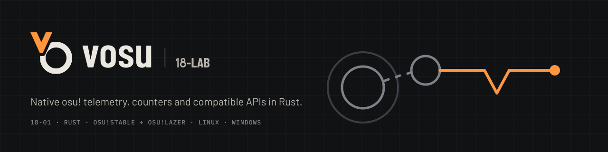

<div align="center">



<p>
  <a href="rust-toolchain.toml"></a>
  <a href="#platform-support"></a>
  <a href="#platform-support"></a>
  <a href="LICENSE"></a>
</p>

</div>

> A vibe-coded Rust implementation targeting API and behavioral compatibility with upstream [tosu](https://github.com/tosuapp/tosu), with native Linux implementation, measured hot paths, and a repository designed to work well with coding agents.

The daemon is implemented in Rust, with an embedded vanilla HTML, CSS, and JavaScript dashboard. Upstream tosu defines the compatibility target. Retained upstream material, the dashboard and calculator replacement history, and unresolved source-provenance questions are documented in [THIRD_PARTY_NOTICES.md](THIRD_PARTY_NOTICES.md) and the [provenance audit](docs/provenance-audit.md). Compatibility does not establish source independence or copyright ownership.

`vosu` reads live state from osu!stable and osu!lazer, then serves the dashboard,
counters, reports, and compatible HTTP/WebSocket APIs. It is one native daemon:
no Node.js, Electron, or separately installed .NET/C# runtime is required.

This build does not provide the former Electron/asdf-overlay in-game overlay or an embedded replacement. External overlay software can consume the documented HTTP and WebSocket APIs; [ADR 0008](docs/decisions/0008-external-in-game-overlays.md) records this product boundary.

## Why this build

| | |
| --- | --- |
| **Native runtime** | A single Rust daemon with embedded dashboard assets and offsets. |
| **Compatibility work** | gosuMemory v1, streamCompanion, and vosu v2 HTTP/WebSocket contracts have targeted checks and fixture evidence. Clean strict Windows stable/lazer captures and their exact source generations are recorded in [verification](docs/testing/verification.md#10-release-gate-strict-windows-stable-2026-10-04). |
| **Linux support** | Native osu!lazer has a [clean strict live-parity capture](docs/testing/verification.md#10-release-gate-strict-native-linux-lazer-2026-10-04) at the recorded source/client pins. osu!stable through Wine is experimental and unverified, not verified release support. |
| **Measured performance** | Criterion covers memory scanning, snapshot reads, calculations, serialization, caching, and publication. Results and limits are recorded in the [benchmark guide](docs/testing/benchmarks.md). |
| **Agent-ready repository** | A pinned toolchain, explicit source ownership, runnable checks, architecture notes, and decision records keep automated changes reviewable. Start with [AGENTS.md](AGENTS.md). |

## Install

### Portable archive

The current source version is **0.3.0**. When its matching [GitHub release](https://github.com/shiruviaa/vosu/releases) is published, download `vosu-linux-v0.3.0.zip` or `vosu-windows-v0.3.0.zip`, then:

1. Extract the complete archive into a writable directory. Its root contains `vosu` or `vosu.exe`, plus `LICENSE`.
2. On Linux, restore the executable bit if your archive tool removed it: `chmod +x vosu`.
3. Run `./vosu` on Linux or `vosu.exe` on Windows.
4. Open <http://127.0.0.1:24050/>. By default, vosu opens the dashboard after startup.

Do not run the Windows executable directly from an archive or a OneDrive-controlled directory. The updater cannot provide safe replacement and rollback in those locations.

### Manual per-user installation

Install into a user-writable location so vosu can update itself without running as root or Administrator. After extracting the release archive, run:

**Linux**

```sh
install -Dm755 vosu "$HOME/.local/bin/vosu"
install -Dm644 LICENSE "$HOME/.local/share/licenses/vosu/LICENSE"
"$HOME/.local/bin/vosu"
```

Add `$HOME/.local/bin` to `PATH` if you want to launch vosu as `vosu`.

**Windows (PowerShell)**

```powershell
$installDir = Join-Path $env:LOCALAPPDATA "Programs\vosu"
New-Item -ItemType Directory -Force $installDir | Out-Null
Copy-Item .\vosu.exe, .\LICENSE $installDir
& "$installDir\vosu.exe"
```

For a later manual upgrade, stop vosu, replace the executable and `LICENSE` with the files from the new complete archive, then restart it.

### Automatic updates

`ENABLE_AUTOUPDATE=true` follows stable `shiruviaa/vosu` releases. The updater verifies the selected platform archive against its published SHA-256 digest, stages exactly one root executable, and uses a crash-recoverable helper and rollback flow.

`POST /api/runUpdates` starts the same update path from the same-origin dashboard. Set `ENABLE_AUTOUPDATE=false` or launch with `--update=false` to disable the startup check. `--update=true` enables it for one launch.

## Command-line options

The public command flags are standalone actions:

```text
-h, --help
-s, --setup
```

`--help` prints usage. Each public action must be the executable's only argument.
On Linux, run `vosu --setup` as the normal desktop user to probe the compiled
process-event backends and install their capabilities. Setup requests
operating-system authentication when needed; do not run the ordinary daemon as
root.

Offset resolution is automatic. For each discovered osu!lazer process, vosu first
checks a valid cache entry for that exact process version, then the matching
embedded offsets asset, and finally runs the embedded self-contained generator
against that exact PID and version. Generation is local and produces an offsets
blob; the daemon validates and atomically installs it in the normal offsets cache.
It never downloads offsets or scans a different process, and a failed generation
does not replace an existing cache entry.

End users do not install .NET, an SDK, a source checkout, or a runtime override.
The generator payload is embedded in release binaries and is extracted into the
normal per-user cache only when an exact process needs generation. A release
binary must contain its matching generator payload; a debug/development binary
without a prepared payload reports an explicit missing-bundle error rather than
falling back to a remote source.

Generation runs both managed helpers with the discovered client's bundled CLR
and framework files in a disposable working directory. This keeps measurement
on the same runtime as the game, including newer .NET versions and osu!'s CLR
fork. The verified embedded payload supplies the helper code; neither the game
installation nor the extracted payload is modified. Linux links the client
runtime files; Windows hard-links them when possible and copies them otherwise.

Offset caches live under the platform cache root:

- Linux: `$XDG_CACHE_HOME/vosu/offsets`, defaulting to `$HOME/.cache/vosu/offsets`.
- Windows: `.cache\offsets` under the portable executable directory (the
  canonical Windows cache root).

Offset entries are keyed by client version and remain the validated
`<version>.json` contract. The separately extracted generator payload cache is
keyed by platform/runtime and embedded bundle checksum, so a helper from another
release build cannot be reused accidentally.

### Prepare an embedded generator bundle (maintainers)

This is a maintainer packaging step for local source builds, not user setup:

```sh
python scripts/prepare-offset-generator.py --rid linux-x64
python scripts/prepare-offset-generator.py --rid win-x64
```

The builder requires Python and the .NET 8 SDK. It restores locked dependencies
and publishes the generator and owned target self-contained for each platform.
Prepared files remain under
`target/offset-generator/<rid>/offset-generator-v1-<rid>.zip` and its
`.zip.sha256` sidecar; generated binaries are never committed. The ZIP is a
self-contained generator/target payload with `LICENSE`, `LICENSE-MIT`,
`LICENSE-APACHE`, `THIRD_PARTY_NOTICES.md`, and its bundle manifest. Release
builds embed only the matching prepared ZIP and checksum, while the release
archive itself remains exactly the executable plus root `LICENSE`.

The separate historical asset-reproduction workflow below remains available to
maintainers updating the vendored `assets/offsets.json`; its SDK and DAC steps
are never user prerequisites and are not part of daemon startup.
## Build from source

### Requirements

- Rust **1.96.1**, also pinned in `rust-toolchain.toml`
- a native toolchain for `x86_64-unknown-linux-gnu` or `x86_64-pc-windows-msvc`
- Linux: a GNU C toolchain, Clang, pkg-config, and libelf/zlib development files for process-event support; GPU driver development libraries are not required
- Windows: MSVC build tools and the Windows SDK

The dashboard and embedded baseline offsets are vendored build inputs. No
frontend or managed-runtime toolchain is needed for debug daemon builds.
Separately producing the versioned offset-generator bundles requires the
maintainer packaging tools listed above; release builds and release-mode
`cargo install` embed the matching prepared bundle.

Debug `cargo build`/`cargo run` may omit a bundle, but generation then reports
the explicit missing-bundle error. `cargo install --path .` builds a release
binary and therefore requires the matching prepared bundle first:

```sh
python scripts/prepare-offset-generator.py --rid linux-x64  # Linux
python scripts/prepare-offset-generator.py --rid win-x64    # Windows
cargo build --locked
cargo run --locked
cargo install --path . --locked
```

Default Linux builds include `linux-process-events`, so a binary installed by the command above can probe eBPF and CN_PROC during `vosu --setup`. Pass `--no-default-features` explicitly only when building a polling-only binary.

Production builds require the matching prepared generator bundle before Cargo
build embeds it:

```sh
python scripts/prepare-offset-generator.py --rid linux-x64
python scripts/prepare-offset-generator.py --rid win-x64
```

```sh
# Linux
cargo build --release --locked --no-default-features --features linux-process-events --target x86_64-unknown-linux-gnu

# Windows, from Developer PowerShell
cargo build --release --locked --no-default-features --target x86_64-pc-windows-msvc
```

The `test-harness` feature is development-only. `build.rs` rejects it in release profiles; it is not a production switch.

### Unsigned version builds

The [Unsigned version builds workflow](.github/workflows/version-build.yml) builds
native Linux GNU and Windows MSVC development ZIPs when a push to `main` changes
the root `Cargo.toml` package version. Dependency-only edits and unchanged versions
skip compilation; manual dispatch builds the selected ref's current version.
These are **unsigned, nonrelease artifacts**, not updater assets or a replacement
for required CI. Downloads identify the version and full commit, expire after
14 days, and include repository attribution/license texts and build provenance.
Run extracted development binaries with `--update=false`. See the
[operations runbook](docs/operations/runbook.md#unsigned-development-artifacts)
for gating, cache, packaging, and smoke-test details. Tagged publication and its
SignPath integration are unchanged; this workflow does not sign or publish releases.

### Reproducibly update the vendored osu!lazer offsets asset

The commands below reproduce the explicitly historical `2026.726.0` asset.
They document prior source, runtime, DAC, and generator inputs; they are not a
recipe for the currently retained `2026.921.0` asset. Provenance for the current
asset is listed in `THIRD_PARTY_NOTICES.md` and Cargo metadata. Do not replace
it from this historical recipe without independently measuring the exact
release/runtime and verifying the native reader.

#### Build only the patched Satori DAC

The AppImage's bundled DAC is the Microsoft runtime DAC and may not match
osu!'s patched Satori `libcoreclr.so`. For live generation, build the pinned
Satori DAC first. The following is the DAC-only portion of the workflow; run it
from the repository root after installing the prerequisites above:

```sh
set -eu
SATORI_ROOT=/tmp/satori-source
SATORI_REVISION=098d0ed17cf8f965d79be6e3d870a895a6dbbe04
SATORI_DAC_PATCH="$PWD/tools/lazer-offset-generator/patches/0001-guard-satori-gc-heap-data.patch"
SATORI_DAC_PATCH_SHA256=e0aaf89fff93b05dad0a4fc272683cbc852a3f51fd8d5b27ac8d91bafd3a597a

git clone --branch 2025.807.0 --depth 1 https://github.com/ppy/Satori.git "$SATORI_ROOT"
git -C "$SATORI_ROOT" checkout --detach "$SATORI_REVISION"
printf '%s  %s\n' "$SATORI_DAC_PATCH_SHA256" "$SATORI_DAC_PATCH" |
  sha256sum --check --strict
git -C "$SATORI_ROOT" apply --check "$SATORI_DAC_PATCH"
git -C "$SATORI_ROOT" apply "$SATORI_DAC_PATCH"
(
  cd "$SATORI_ROOT"
  ./build.sh clr.nativeprereqs -c Release
  printf 'static char sccsid[] __attribute__((used)) = "@(#)Version 0.0 @Commit: %s @Patch: %s";\n' \
    "$SATORI_REVISION" "$SATORI_DAC_PATCH_SHA256" > artifacts/obj/_version.c
  ./src/coreclr/build-runtime.sh -x64 -os linux -release -component debug
)
export VOSU_LAZER_OFFSET_DAC="$SATORI_ROOT/artifacts/bin/coreclr/linux.x64.Release/libmscordaccore.so"
test -f "$VOSU_LAZER_OFFSET_DAC"
```

This DAC procedure belongs only to historical vendored-asset reproduction. It
does not participate in runtime offset generation: current generation uses the
embedded self-contained generator and the exact live PID.

**Historical recipe:** this checked-in procedure reproduces the prior
`2026.726.0` offsets asset using the .NET 8.0.29/Satori inputs listed in
`THIRD_PARTY_NOTICES.md`; it is not a recipe or provenance for the currently
retained `2026.921.0` asset. The current asset was measured from the
`2026.921.0-lazer` AppImage under its bundled .NET 10.0.12 runtime; its release,
source revision, AppImage hash, and asset hash are recorded in Cargo metadata
and the notices. Do not substitute this historical recipe when reproducing
current offsets; native live-reader verification remains required.

These Linux x64 maintainer tools can derive the vendored `assets/offsets.json`
asset from an exact release source checkout under that release's exact runtime.
The remaining commands below are the historical `2026.726.0` reproduction
procedure only. They require the .NET 8 SDK, `curl`, `bsdtar`, binutils, zlib
development headers, an executable `/dev/shm` tmpfs, and the [Satori Linux build
prerequisites](https://github.com/ppy/Satori/blob/098d0ed17cf8f965d79be6e3d870a895a6dbbe04/.github/workflows/build.yml);
these do not describe current `2026.921.0` provenance. vosu builds and releases
remain Rust-only apart from preparing the embedded generator bundle.

```sh
set -eu
VOSU_ROOT=$(pwd -P)
OSU_TAG=2026.726.0-lazer
OSU_VERSION=2026.726.0
OSU_REVISION=5da71008b082d1a77e4bb301dc98886f1f24b895
OSU_APPIMAGE=/tmp/osu-2026.726.0-lazer.AppImage
OSU_APPIMAGE_SHA256=3d3028609543dffd037b00652603f75928515100b6245bc929a9dc46fd3b29a0
SATORI_TAG=2025.807.0
SATORI_REVISION=098d0ed17cf8f965d79be6e3d870a895a6dbbe04
SATORI_DAC_PATCH="$VOSU_ROOT/tools/lazer-offset-generator/patches/0001-guard-satori-gc-heap-data.patch"
SATORI_DAC_PATCH_SHA256=e0aaf89fff93b05dad0a4fc272683cbc852a3f51fd8d5b27ac8d91bafd3a597a
SATORI_ARCHIVE=/tmp/satori-2025.807.0-linux-x64.zip
SATORI_ARCHIVE_SHA256=aef780b177f77caf463d986cdb030366866bb3502039473dcc71dd2bdeb68fd2
SATORI_CORELIB_SHA256=73c6ae7ff2ed535a249539f78731fc4412cf6c263ed9692fcf035f2cd01f96fa
SATORI_CLRJIT_SHA256=3d58119a829d10d20f9fc31f2144f9202af19c93b412d5a5eeeeeba4b35ebb3e
SATORI_CORECLR_SHA256=dcc631eda8fdb34d06956697e9709b8d828306eb73ac3187b5058180e1af615e
SATORI_CORECLR_BUILD_ID=924f6642f039382780dd0ee782477271d8093084
RUNTIME_PACK=/tmp/microsoft.netcore.app.runtime.linux-x64.8.0.29.nupkg
RUNTIME_PACK_SHA256=780e71f4d31f0a0e8985198e28aa9f04bf3e4f0b505bfd4e36f25e00d3c93850
HOST_PACK=/tmp/microsoft.netcore.app.host.linux-x64.8.0.29.nupkg
HOST_PACK_SHA256=4ff7979334f75774f561ab1cd5c519fe32ce589637ce9fc6c494c24f6e209c0c
REF_PACK=/tmp/microsoft.netcore.app.ref.8.0.29.nupkg
REF_PACK_SHA256=77102e11453554e1254380a92fd1cb855e0a545b510c07194bc5b4193d838ba8
RUNTIME_PACK_SOURCE=/tmp/vosu-runtime-pack-source
RUNTIME_PACKAGES=/tmp/vosu-runtime-packages
TARGETING_PACK_ROOT=/tmp/vosu-empty-targeting-packs
DOTNET_CLI_HOME=/tmp/vosu-dotnet-cli-home
WORKLOAD_PACK_ROOTS=/tmp/vosu-empty-workload-packs
printf '%s  %s\n' "$SATORI_DAC_PATCH_SHA256" "$SATORI_DAC_PATCH" |
  sha256sum --check --strict

rm -rf /tmp/osu-offset-source
git clone --branch "$OSU_TAG" --depth 1 https://github.com/ppy/osu.git /tmp/osu-offset-source
test "$(git -C /tmp/osu-offset-source rev-parse "${OSU_TAG}^{commit}")" = "$OSU_REVISION"
git -C /tmp/osu-offset-source checkout --detach "$OSU_REVISION"
test "$(git -C /tmp/osu-offset-source rev-parse HEAD)" = "$OSU_REVISION"

curl --fail --location --output "$OSU_APPIMAGE" \
  "https://github.com/ppy/osu/releases/download/$OSU_TAG/osu.AppImage"
printf '%s  %s\n' "$OSU_APPIMAGE_SHA256" "$OSU_APPIMAGE" |
  sha256sum --check --strict
chmod u+x "$OSU_APPIMAGE"
rm -rf /tmp/osu-appimage-runtime
mkdir -p /tmp/osu-appimage-runtime
(
  cd /tmp/osu-appimage-runtime
  "$OSU_APPIMAGE" --appimage-extract 'usr/bin/*.dll'
  "$OSU_APPIMAGE" --appimage-extract usr/bin/libclrjit.so
  "$OSU_APPIMAGE" --appimage-extract usr/bin/libcoreclr.so
  "$OSU_APPIMAGE" --appimage-extract 'usr/bin/osu!.runtimeconfig.json'
  "$OSU_APPIMAGE" --appimage-extract 'usr/bin/osu!.deps.json'
)
OSU_RUNTIME_DIR=/tmp/osu-appimage-runtime/squashfs-root/usr/bin
OSU_RUNTIME_CONFIG="$OSU_RUNTIME_DIR/"'osu!.runtimeconfig.json'
OSU_DEPS="$OSU_RUNTIME_DIR/"'osu!.deps.json'
OSU_ASSEMBLY_DIR=/tmp/osu-appimage-assemblies
rm -rf "$OSU_ASSEMBLY_DIR"
mkdir -p "$OSU_ASSEMBLY_DIR"
cp "$OSU_RUNTIME_DIR"/*.dll "$OSU_ASSEMBLY_DIR/"
rm "$OSU_ASSEMBLY_DIR/System.Private.CoreLib.dll"
test -f "$OSU_ASSEMBLY_DIR/"'osu!.dll'
test -f "$OSU_ASSEMBLY_DIR/osu.Game.dll"
test -f "$OSU_ASSEMBLY_DIR/osu.Framework.dll"
printf '%s  %s\n' \
  "$SATORI_CORELIB_SHA256" "$OSU_RUNTIME_DIR/System.Private.CoreLib.dll" \
  "$SATORI_CLRJIT_SHA256" "$OSU_RUNTIME_DIR/libclrjit.so" \
  "$SATORI_CORECLR_SHA256" "$OSU_RUNTIME_DIR/libcoreclr.so" |
  sha256sum --check --strict
readelf --notes "$OSU_RUNTIME_DIR/libcoreclr.so" |
  grep --fixed-strings "Build ID: $SATORI_CORECLR_BUILD_ID"
grep --fixed-strings '"version": "8.0.29"' "$OSU_RUNTIME_CONFIG"
grep --fixed-strings \
  '"runtimepack.Microsoft.NETCore.App.Runtime.linux-x64": "8.0.29"' \
  "$OSU_DEPS"
grep -A 2 --fixed-strings '"System.Private.CoreLib.dll"' \
  "$OSU_DEPS" |
  grep --fixed-strings '"fileVersion": "8.0.2926.32403"'

curl --fail --location --output "$SATORI_ARCHIVE" \
  "https://github.com/ppy/Satori/releases/download/$SATORI_TAG/linux-x64.zip"
printf '%s  %s\n' "$SATORI_ARCHIVE_SHA256" "$SATORI_ARCHIVE" |
  sha256sum --check --strict
rm -rf /tmp/satori-runtime
mkdir -p /tmp/satori-runtime
bsdtar -xf "$SATORI_ARCHIVE" -C /tmp/satori-runtime
SATORI_RUNTIME_DIR=/tmp/satori-runtime/linux-x64
printf '%s  %s\n' \
  "$SATORI_CORELIB_SHA256" "$SATORI_RUNTIME_DIR/System.Private.CoreLib.dll" \
  "$SATORI_CLRJIT_SHA256" "$SATORI_RUNTIME_DIR/libclrjit.so" \
  "$SATORI_CORECLR_SHA256" "$SATORI_RUNTIME_DIR/libcoreclr.so" |
  sha256sum --check --strict
cmp --silent "$SATORI_RUNTIME_DIR/System.Private.CoreLib.dll" \
  "$OSU_RUNTIME_DIR/System.Private.CoreLib.dll"
cmp --silent "$SATORI_RUNTIME_DIR/libclrjit.so" "$OSU_RUNTIME_DIR/libclrjit.so"
cmp --silent "$SATORI_RUNTIME_DIR/libcoreclr.so" "$OSU_RUNTIME_DIR/libcoreclr.so"

rm -rf /tmp/satori-source
git clone --branch "$SATORI_TAG" --depth 1 \
  https://github.com/ppy/Satori.git /tmp/satori-source
test "$(git -C /tmp/satori-source rev-parse "${SATORI_TAG}^{commit}")" = "$SATORI_REVISION"
git -C /tmp/satori-source checkout --detach "$SATORI_REVISION"
test "$(git -C /tmp/satori-source rev-parse HEAD)" = "$SATORI_REVISION"
git -C /tmp/satori-source apply --check "$SATORI_DAC_PATCH"
git -C /tmp/satori-source apply "$SATORI_DAC_PATCH"
(
  cd /tmp/satori-source
  ./build.sh clr.nativeprereqs -c Release
  printf 'static char sccsid[] __attribute__((used)) = "@(#)Version 0.0 @Commit: %s @Patch: %s";\n' \
    "$SATORI_REVISION" "$SATORI_DAC_PATCH_SHA256" > artifacts/obj/_version.c
  ./src/coreclr/build-runtime.sh -x64 -os linux -release -component debug
)
SATORI_DAC=/tmp/satori-source/artifacts/bin/coreclr/linux.x64.Release/libmscordaccore.so
test -f "$SATORI_DAC"
strings "$SATORI_DAC" |
  grep --fixed-strings \
    "@(#)Version 0.0 @Commit: $SATORI_REVISION @Patch: $SATORI_DAC_PATCH_SHA256"

curl --fail --location --output "$RUNTIME_PACK" \
  "https://api.nuget.org/v3-flatcontainer/microsoft.netcore.app.runtime.linux-x64/8.0.29/microsoft.netcore.app.runtime.linux-x64.8.0.29.nupkg"
curl --fail --location --output "$HOST_PACK" \
  "https://api.nuget.org/v3-flatcontainer/microsoft.netcore.app.host.linux-x64/8.0.29/microsoft.netcore.app.host.linux-x64.8.0.29.nupkg"
curl --fail --location --output "$REF_PACK" \
  "https://api.nuget.org/v3-flatcontainer/microsoft.netcore.app.ref/8.0.29/microsoft.netcore.app.ref.8.0.29.nupkg"
printf '%s  %s\n' \
  "$RUNTIME_PACK_SHA256" "$RUNTIME_PACK" \
  "$HOST_PACK_SHA256" "$HOST_PACK" \
  "$REF_PACK_SHA256" "$REF_PACK" |
  sha256sum --check --strict
rm -rf "$RUNTIME_PACK_SOURCE" "$RUNTIME_PACKAGES" "$TARGETING_PACK_ROOT" \
  "$DOTNET_CLI_HOME" "$WORKLOAD_PACK_ROOTS"
mkdir -p "$RUNTIME_PACK_SOURCE" "$RUNTIME_PACKAGES" "$TARGETING_PACK_ROOT" \
  "$DOTNET_CLI_HOME" "$WORKLOAD_PACK_ROOTS"
install -m 0644 "$RUNTIME_PACK" "$RUNTIME_PACK_SOURCE/"
install -m 0644 "$HOST_PACK" "$RUNTIME_PACK_SOURCE/"
install -m 0644 "$REF_PACK" "$RUNTIME_PACK_SOURCE/"

TARGET_PROJECT=tools/lazer-offset-target/lazer-offset-target.csproj
TARGET_PUBLISH=tools/lazer-offset-target/bin/Release/net8.0/linux-x64/publish
rm -rf "$TARGET_PUBLISH" tools/lazer-offset-target/obj
DOTNET_CLI_HOME="$DOTNET_CLI_HOME" \
DOTNET_MULTILEVEL_LOOKUP=0 \
WORKLOAD_PACK_ROOTS="$WORKLOAD_PACK_ROOTS" \
NUGET_PACKAGES="$RUNTIME_PACKAGES" \
  dotnet publish "$TARGET_PROJECT" \
  --configuration Release \
  --runtime linux-x64 \
  --self-contained true \
  --source "$RUNTIME_PACK_SOURCE" \
  --no-cache \
  -p:RuntimeFrameworkVersion=8.0.29 \
  -p:NetCoreTargetingPackRoot="$TARGETING_PACK_ROOT" \
  -p:WORKLOAD_PACK_ROOTS="$WORKLOAD_PACK_ROOTS" \
  -p:RestorePackagesPath="$RUNTIME_PACKAGES" \
  -p:RestoreFallbackFolders= \
  -p:DisableTransitiveFrameworkReferenceDownloads=true
install -m 0644 "$SATORI_RUNTIME_DIR/System.Private.CoreLib.dll" \
  "$TARGET_PUBLISH/System.Private.CoreLib.dll"
install -m 0755 "$SATORI_RUNTIME_DIR/libclrjit.so" "$TARGET_PUBLISH/libclrjit.so"
install -m 0755 "$SATORI_RUNTIME_DIR/libcoreclr.so" "$TARGET_PUBLISH/libcoreclr.so"
printf '%s  %s\n' \
  "$SATORI_CORELIB_SHA256" "$TARGET_PUBLISH/System.Private.CoreLib.dll" \
  "$SATORI_CLRJIT_SHA256" "$TARGET_PUBLISH/libclrjit.so" \
  "$SATORI_CORECLR_SHA256" "$TARGET_PUBLISH/libcoreclr.so" |
  sha256sum --check --strict
GENERATOR_PACKAGES=$(mktemp -d /tmp/vosu-lazer-offset-generator-packages.XXXXXX)
NUGET_PACKAGES="$GENERATOR_PACKAGES" \
  dotnet restore tools/lazer-offset-generator/lazer-offset-generator.csproj \
  --source https://api.nuget.org/v3/index.json \
  --no-cache \
  --locked-mode \
  -p:RestorePackagesPath="$GENERATOR_PACKAGES"
NUGET_PACKAGES="$GENERATOR_PACKAGES" \
  dotnet build tools/lazer-offset-generator/lazer-offset-generator.csproj \
  --configuration Release \
  --no-restore \
  -p:RestorePackagesPath="$GENERATOR_PACKAGES"
rm -rf "$GENERATOR_PACKAGES"
TARGET_RUNTIME=$(mktemp -d /dev/shm/vosu-lazer-offset-target.XXXXXX)
trap 'rm -rf "$TARGET_RUNTIME"' EXIT
test "$(stat -f -c %T "$TARGET_RUNTIME")" = tmpfs
cp -aL "$TARGET_PUBLISH/." "$TARGET_RUNTIME/"
printf '%s  %s\n' \
  "$SATORI_CORELIB_SHA256" "$TARGET_RUNTIME/System.Private.CoreLib.dll" \
  "$SATORI_CLRJIT_SHA256" "$TARGET_RUNTIME/libclrjit.so" \
  "$SATORI_CORECLR_SHA256" "$TARGET_RUNTIME/libcoreclr.so" |
  sha256sum --check --strict
"$TARGET_RUNTIME/lazer-offset-target" --help >/dev/null
```

The AppImage declares the Microsoft `linux-x64` runtime pack 8.0.29 and its dependency manifest records `System.Private.CoreLib.dll` file version `8.0.2926.32403`. osu!'s deployment then overlays ppy/Satori 2025.807.0, whose exact source reports product version 8.0.16, for `System.Private.CoreLib.dll`, `libclrjit.so`, and `libcoreclr.so`. The archive and per-file checks above prove those three Satori files are byte-identical to the official AppImage. Satori's non-official release gives the CoreCLR ELF a native marker of `42.42.42.42424`, while pinned ClrMD reports this stripped Linux runtime's comparable file version as the two-component `0.0`; the DAC therefore embeds `0.0`, the verified Satori commit, and the committed compatibility-patch hash. The stock Microsoft DAC is not a valid substitute for the Satori GC.

The commands restore the hash-verified Microsoft runtime, host, and reference packages through a fresh local NuGet source and `NUGET_PACKAGES` directory, with fallback and transitive framework-reference downloads disabled. Fresh empty targeting-pack and workload-pack roots, a fresh CLI home, and disabled multilevel lookup prevent the SDK from substituting installed or user-local packs. The target project also pins the `Microsoft.NETCore.App` targeting pack to 8.0.29, so SDK defaults cannot request another patch. The authoritative runtime identity is the AppImage-matched Satori CoreLib, JIT, and CoreCLR trio installed after publish and verified again by both tools.

The generator restore's committed lock file fixes the entire ClrMD dependency graph, and NuGet validates each restored package against the lock's `contentHash` while using only the explicit nuget.org source and fresh private package root.

Satori does not populate the standard GC DAC globals, but its unmodified `GetGCHeapData` and `GetGCHeapStaticData` implementations dereference them while ClrMD constructs a runtime. The pinned compatibility patch prevents those invalid reads: it reports Satori's single-heap topology with GC structures unavailable and returns `E_NOTIMPL` for the unsupported static heap query. The generator does not inspect managed heap objects; module, type, method-table, and field metadata still come from the matching Satori DAC. The generator rejects a DAC without the exact version, source-commit, and compatibility-patch markers and leaves ClrMD's version-mismatch check enabled.

Run the generator once. It launches the pinned target executable as its direct child and always terminates and reaps that child:

```sh
tools/lazer-offset-generator/bin/Release/net8.0/lazer-offset-generator \
  --target-host "$TARGET_RUNTIME/lazer-offset-target" \
  --dac "$SATORI_DAC" \
  --assembly-dir "$OSU_ASSEMBLY_DIR" \
  --template assets/offsets.json \
  --output assets/offsets.json
rm -rf "$TARGET_RUNTIME"
trap - EXIT
```

Before printing its ready line, the target host verifies Linux x64, Satori product version 8.0.16, and the exact loaded Satori CoreLib, JIT, and CoreCLR hashes. It then loads the hash-verified official AppImage's managed assemblies in an isolated load context and retains every template type's runtime handle; the staged assembly directory omits `System.Private.CoreLib.dll` so that framework identity comes only from the already verified target runtime. It does not inspect fields or compute layouts. The generator explicitly loads the matching source-built Satori DAC with the committed compatibility patch through the pinned Microsoft.Diagnostics.Runtime (ClrMD) package. ClrMD alone resolves loaded type definitions, declaring types, inherited instance fields, field offsets, and the concrete `osu.Desktop.OsuGameDesktop` method-table word. The official AppImage does not construct every required state-specific method table during normal startup, so the target host activates those types under the exact Satori runtime while preserving the AppImage's managed assembly bytes.

The commands stage the complete target publish on a fresh executable tmpfs and re-hash the pinned runtime trio after copying. Before launch, the generator hashes all three files through held descriptors and records each device, inode, size, and nanosecond change time. The target requires those exact pre-launch stamps, binds each descriptor to `/proc/self/maps`, and verifies the hashes; after reaping the target, the generator verifies the held descriptors and hashes again. The change-time checks reject an in-place write even if the original bytes are restored, while strict device-and-inode matching rejects path or Btrfs-subvolume substitution. The generator copies the supplied DAC into a sealed anonymous file, validates the markers in that immutable snapshot, and gives ClrMD its `/proc/self/fd` path; validation and loading therefore use identical bytes. Generated JSON is kept in memory until target termination, reaping, and final runtime verification all succeed, so cleanup or identity failure cannot print or replace output.

On Linux, the generator keeps the target as its direct child for the entire ClrMD attach, preserving the relationship expected by Yama restricted-ptrace mode; ordinary ptrace eligibility still applies. Neither tool installs a target-side ptrace exception or changes system ptrace policy. A runtime-identity mismatch, DAC mismatch, missing or ambiguous type, or missing or ambiguous field fails without replacing the output. After reviewing the diff, update the `assets/offsets.json` entry in `assets/SHA256SUMS`, then record the exact osu! and Satori source revisions, release tags and URLs, input archive hashes, runtime identities, and generated JSON SHA-256 in `package.metadata.vosu` and `THIRD_PARTY_NOTICES.md`.

The JSON schema is the embedded and cache offset interchange contract
(`<version>.json`). Replacing this 7,892-byte asset with a packed format would
require a separately versioned parser and cache migration; generation must not
silently change the deployed format.

## Platform support

Run vosu as the same desktop user as osu!. Tournament and debug-client processes are filtered by command line.

Discovery admits only processes owned by the daemon's desktop account: the real UID on Linux and the primary-token user SID on Windows. Linux memory handles also check the captured process generation around reads; PID reuse is not a new authorized target. Run separate daemon instances for separate desktop accounts.

| Platform | osu!stable | osu!lazer |
| --- | --- | --- |
| **Linux** | **Experimental; not release-verified.** Wine process discovery and native memory reads exist. Set `VOSU_OSU_PATH=/absolute/path/to/osu!` if Wine does not expose the install directory. | The official executable or AppImage layout must expose `osu!.deps.json`. Sandbox policy must allow process discovery and memory reads. |
| **Windows** | Supported 32-bit processes are read through native Windows process-memory APIs. | A supported 64-bit process is required. Offsets are resolved from the valid versioned cache, embedded data, then the embedded generator against that exact process. |

On Linux, vosu can also read the osu! path from `${XDG_DATA_HOME:-$HOME/.local/share}/osuconfig/osupath`.

Official Linux archives statically include libbpf and dynamically use the system `libelf.so.1` and `libz.so.1` libraries.

On Linux, `process_vm_readv` must be permitted. During ordinary startup vosu checks the running process's effective capability set and warns if `CAP_SYS_PTRACE` is not effective, or if that check cannot be completed. The warning does not stop startup, but memory reads may fail. Configure the exact executable with:

```sh
vosu --setup
```

An unprivileged `--setup` validates the current executable, then launches that exact executable and `--setup` through a trusted, root-owned, non-writable `pkexec`. Polkit owns the graphical or terminal credential prompt; vosu never reads, logs, or retains the password. An already-root setup skips `pkexec` and does not prompt. Authentication cancellation or failure, an unavailable/noninteractive authentication agent, and a missing trusted `pkexec` all exit unsuccessfully before `setcap` runs, so they leave the executable unchanged. There is no sudo fallback.

After authentication, the elevated setup directly invokes a trusted, root-owned `setcap` executable and exits without starting the daemon. A normal build receives only `CAP_SYS_PTRACE` and reports polling as its available discovery backend. A build compiled with `linux-process-events` first attempts its maximum compiled capability set. When that succeeds, it re-executes itself to probe eBPF and CN_PROC independently, then retains `CAP_SYS_RESOURCE`, `CAP_PERFMON`, and `CAP_BPF` only when eBPF actually works. If the maximum set is unavailable, setup retries with `CAP_SYS_PTRACE`, marks eBPF unavailable, and still probes CN_PROC before reporting polling as the final fallback. CN_PROC requires no additional file capability. Probe failures and the final capability set are printed. A failed capability transaction removes transient capabilities; if rollback itself fails, setup reports that the executable must be verified before use.

If `setcap` lacks authority, setup exits unsuccessfully without starting the daemon. Executable replacement, including an automatic update, removes file capabilities, so rerun `vosu --setup` after replacing vosu.

With `linux-process-events` compiled, an unset `VOSU_PROCESS_EVENTS` selects `auto`: runtime tries eBPF, falls back to CN_PROC, then polling. Set `VOSU_PROCESS_EVENTS=off` or `poll` to force polling, or select `ebpf` or `cn-proc` explicitly.

Do not run the ordinary vosu daemon as root to bypass ptrace or eBPF policy. Pattern or offset resolution may remain pending and retry while the process is alive; that alone does not confirm support for a game build.

## Files and migration

### Linux

The daemon follows XDG directories and appends `vosu`:

| Data | Path |
| --- | --- |
| Configuration | `${XDG_CONFIG_HOME:-$HOME/.config}/vosu/vosu.toml` |
| Counters | `${XDG_DATA_HOME:-$HOME/.local/share}/vosu/static/` |
| Counter schema | `${XDG_DATA_HOME:-$HOME/.local/share}/vosu/static/<counter>/settings.schema.toml` |
| Counter values | `${XDG_CONFIG_HOME:-$HOME/.config}/vosu/settings/<counter>.settings.values.toml` |
| Cache | `${XDG_CACHE_HOME:-$HOME/.cache}/vosu/` |

### Windows

The directory containing `vosu.exe` is the program, configuration, and data root:

| Data | Path |
| --- | --- |
| Configuration | `<program>/vosu.toml` |
| Counters | `<program>/static/` |
| Counter schema | `<program>/static/<counter>/settings.schema.toml` |
| Counter values | `<program>/settings/<counter>.settings.values.toml` |
| Cache | `<program>/.cache/` |
| Logs | Runtime log directory below the program location |

An absolute `STATIC_FOLDER_PATH` is used as written. A custom relative path is resolved from the launch directory. The defaults `./static` and `.\static` map to the platform data root.

On first start after the rename, vosu performs a one-time, idempotent state migration. On Linux it moves files from the former `tosu` XDG config, data, and cache roots into the corresponding `vosu` roots without overwriting state already present there, then removes empty former roots. On every platform, configuration migration layers defaults, readable `tosu.env`, readable `vosu.env`, and canonical `vosu.toml` with precedence `vosu.toml > vosu.env > tosu.env > defaults`. The legacy dotenv files are migration inputs only. It writes canonical TOML to `vosu.toml` through an atomic same-directory replacement; if canonical TOML is malformed at startup, all source files remain untouched. After migration, vosu reads and writes only canonical `vosu.toml`; legacy counter settings inputs remain untouched.
For each counter, the package root's `settings.schema.toml` is the authoritative schema and developer schema saves write that file. Steady-state config storage contains only mutable values at `<config>/settings/<counter>.settings.values.toml`. When the root schema is missing, vosu creates it from root `settings.json` when present, otherwise by inferring setting types from scalar root `settings.toml`: strings become `text`, integers/floats become `number`, booleans become `checkbox`, and each key supplies `uniqueID`/`title` with the scalar as its default. Arrays, nested tables, and datetimes are rejected as ambiguous without creating a schema or modifying package inputs. Only after package sources does loading fall back to old config `<counter>.settings.toml` or `<counter>.settings.json`; every legacy counter schema and values input remains byte-for-byte untouched after canonical schema and values are created. Root JSON and TOML inputs remain untouched, and when both exist JSON defines the schema while TOML may seed values.

## Configuration

Edit `vosu.toml` in the platform configuration root. It is a flat, typed TOML document with uppercase binding names. The daemon watches its parent directory and applies supported changes without restarting. Writes use a temporary file in the same directory, flush and sync it, then atomically replace the target.

```toml
ENABLE_AUTOUPDATE = true
OPEN_DASHBOARD_ON_STARTUP = true
POLL_RATE = 150.0
PRECISE_DATA_POLL_RATE = 10.0
SERVER_IP = "127.0.0.1"
SERVER_PORT = 24050.0
STATIC_FOLDER_PATH = "./static"
ALLOWED_IPS = "127.0.0.1,localhost,absolute"
```

At startup, malformed canonical TOML leaves every source file untouched. During watch reload, malformed TOML leaves the last-good runtime configuration and dependent resources active.

| Binding | Default | Meaning |
| --- | ---: | --- |
| `ENABLE_AUTOUPDATE` | `true` | Check for and install stable vosu releases. |
| `OPEN_DASHBOARD_ON_STARTUP` | `true` | Open the effective dashboard listener after startup. |
| `DEBUG_LOG` | `false` | Include debug-level file and console logging. |
| `CALCULATE_PP` | `true` | Enable live performance calculations. |
| `ENABLE_KEY_OVERLAY` | `true` | Publish key-overlay data in compatible schemas. |
| `POLL_RATE` | `150` | Regular state interval in milliseconds; range `100`–`60000`. |
| `PRECISE_DATA_POLL_RATE` | `10` | Precise state interval in milliseconds; range `1`–`60000`. |
| `V2_SUBSCRIPTION_DEBOUNCE` | `0` | Minimum interval in milliseconds between selected-field WebSocket frames; range `0`–`60000`, fractional values supported. |
| `SHOW_MP_COMMANDS` | `false` | Include multiplayer commands where supported. |
| `READ_MANIA_SCROLL_SPEED` | `true` | Read mania scroll speed. |
| `SERVER_IP` | `127.0.0.1` | Listener hostname or address. |
| `SERVER_PORT` | `24050` | Listener port. |
| `STATIC_FOLDER_PATH` | `./static` | Counter root; the default maps to the data directory. |
| `ALLOWED_IPS` | `127.0.0.1,localhost,absolute` | Peer IP patterns and allowed Origin/Referer host tokens. |

Disk configuration clamps oversized/nonfinite intervals to `60000` ms with a warning. Settings API updates above that ceiling fail without publishing or persisting any part of the update.

Authorization requires an allowed network peer and, when supplied, an allowed `Origin` or `Referer`. A hostname token does not allow an arbitrary remote peer. Keep the default loopback listener unless remote access is intentionally configured and protected.


## Dashboard and counters

The dashboard at `/` discovers counters recursively below the static root. A counter normally contains `index.html`. `metadata.txt` can add a name, author links, description, version, and `WxH` size. An immediate `ignore.txt` excludes its directory from discovery, and directories named `node_modules` are never traversed. Mutation APIs accept counter names containing one normal path component.

Discovery accepts at most 4096 named metadata/index files; each `metadata.txt` must be a regular file no larger than 64 KiB. Counter installation admits four concurrent jobs across static-root reloads; additional requests receive HTTP 429. Shutdown cancels and joins admitted jobs even when their initiating HTTP client disconnects.

A top-level directory symlink directly below the static root is an explicit local mount declaration and may target a directory outside that root; no `index.html` marker is required for authorization. Discovery follows that top-level alias but skips nested directory symlinks, which neither create nor traverse additional mount roots. Every requested file below the alias is still confined to the current alias target and streamed through a retained handle. Counter settings remain available through aliases, while final symlinked settings files are rejected and settings writes use atomic same-directory replacement. **Open Folder** follows a directory alias. **Delete** unlinks the alias itself without traversing or deleting its target.

Installed overlays appear as equal-size cards, at most four per row: a preview frame that contains each counter at its declared `WxH` resolution (small counters are enlarged up to 2×), the name, version, author, and size (click the size to copy it), and a URL bar that copies the counter's OBS URL on click (Shift-click opens it). Click a preview to open an enlarged live view in a dialog. Pin a card with its pin toggle; pinned cards stay above unpinned cards in their saved order, and **Move pin earlier/later** in the card's **⋯** menu reorders them. That menu also holds **Open folder** and **Delete**. Pins are stored per browser origin, so `localhost` and `127.0.0.1`, or a different port, keep separate pins. Available overlays are a one-per-row listing: one catalog preview image at a time, with arrows to browse the rest and a click to enlarge, beside the name, author links, size, intended use, compatible clients, and the install or update action. Preview images load lazily from the catalog's image URLs (currently `raw.githubusercontent.com`) without a referrer. The page tabs and search live in the top bar; press `/` outside an editable control to focus search. Installed search filters the loaded cards in place, Available search queries the catalog, and Settings search filters the options. Runtime settings save individually when a field loses focus or a checkbox changes; blank or out-of-range numbers are rejected in place rather than saved. Changing the listener address or port waits for the new listener and then reconnects the page.

Counter settings support text, color, number, checkbox, button, options, commands, textarea, password, header entries. Each counter package owns its authoritative schema at `<static-root>/<counter>/settings.schema.toml`; only mutable values are stored centrally at `<config>/settings/<counter>.settings.values.toml`. `/settings` page handles daemon counter settings.

The counter catalog is served by the upstream tosu service at `https://tosu.app/api.json`; vosu does not operate a website. Production counter downloads require HTTPS. Redirects are bounded; HTTPS-to-HTTP downgrades and loopback, private, or reserved destinations are rejected. ZIP paths, symlinks, entry counts, and expanded size are checked before same-filesystem replacement.

## HTTP API

Methods and paths are exact. Unsupported combinations return `404 Not Found`. State endpoints return `500 {"error":"osu is not ready/running"}` until an instance is focused.

### State and calculation

| Route | Response |
| --- | --- |
| `GET /json` | gosuMemory-compatible v1 snapshot |
| `GET /json/sc` | streamCompanion-compatible snapshot |
| `GET /json/v2` | vosu v2 snapshot |
| `GET /json/v2/precise` | vosu precise snapshot |
| `GET /api/calculate/pp` | Legacy `rosu-pp` calculation; uses the current beatmap unless `path` names a canonical regular `.osu` file |

Calculator file inputs are limited to 64 MiB, including opened-handle checks and bounded reads. The live calculator facade additionally admits at most 250,000 parsed objects with finite start timestamps within ±10,000,000 ms. Supported effective clock rates are `0.01`–`100`. Graph output is limited to 1,000,000 aggregate bins; excessive audio padding yields an empty graph. These are per-input limits, not a process-wide concurrent-calculation memory ceiling.

The v2 snapshot and matching WebSocket streams expose `beatmap.stats.hitWindow`. The object has optional numeric judgement fields `miss`, `meh`, `ok`, `good`, `great`, and `perfect`; unsupported judgements are omitted. Values are maximum absolute timing errors in milliseconds after the active clock rate is applied. An unparsed/missing map serializes an empty object. Catch publishes all six fields as zero, matching upstream's empty-window implementation, while `stars.hitWindow` remains absent. Catch's spatial catcher width is not a timing window.

The tosu hit-error arrays keep their original names and shapes: `hitErrorArray` in v1 and regular v2, and `hitErrors` in streamCompanion and precise v2. Vosu adds sibling `pressHitErrors` and `releaseHitErrors` arrays. The original array preserves every timing event in order, `pressHitErrors` contains note presses, and `releaseHitErrors` contains osu!mania hold-note releases. Stable is press-only outside native mania maps; native mania uses beatmap metadata and replay input transitions to classify hold-note releases. Classification can lag the original array while evidence is pending; converted or unavailable map metadata remains press-only.

Hit-error capture and appends require a fresh `play` state, including the opening 150 ms. Polling before the first object, a temporarily shrinking native event list, and unavailable precise status do not clear accumulated arrays. Pause and results retain the current attempt's history. Returning to song selection or otherwise exiting the attempt clears it; a genuine quick retry starts a fresh attempt.

Regular and precise v2 responses include a mode-free `keys` object. Its tosu-compatible `k1`, `k2`, `m1`, and `m2` members remain unchanged; the additive `all` array contains every source-reported logical input in order, with `name`, `isPressed`, `count`, `pressedAt`, and `releasedAt`. Edge timestamps are nullable gameplay milliseconds. They update only when the sampled state exposes that edge, so a count jump can report missed complete taps without fabricating timestamps.

These additive hit-error and `keys.all` fields are planned for a tosu port soon(tm). Until that lands, overlays targeting both servers must treat them as optional. Existing tosu overlays can use vosu's regular and precise v2 streams without adapting to the extensions.

Maintainers can run the zero-dependency harness with `cd tools/input-validation && uv run python run.py ...`. `capture` accounts for precise transitions and `scan-maps` selects long-note-heavy mania maps. `autoplay <map.osu>` and `live-autoplay <map.osu>` generate deterministic plans for osu!, taiko, catch, and mania, then inject them through Windows `SendInput` or Linux `/dev/uinput`; live mania plans additionally support bounded seeded timing jitter. Standard-mode and catch pointer injection requires `--playfield x,y,width,height`; Linux also requires the full compositor layout as `--desktop x,y,width,height`, not only the target monitor. Default controls are `Z` for osu!, `F,J,D,K` for taiko plan controls `DON_LEFT,DON_RIGHT,KAT_LEFT,KAT_RIGHT`, pointer-only for catch, and `D,F,J,K` for 4-key mania.

Maintainer workflow, evidence interpretation, troubleshooting, and maintenance triggers are documented in the [precise input validation guide](docs/testing/input-validation.md).

`navigate` follows keyboard paths from an unobstructed idle logo: lazer uses `P,P,P` for song select and `P,P,M,M` for multiplayer, while stable uses `P,P,P` and `P,P,M`. Navigation key-down onsets default to 100 ms apart. Optional song-select search text uses 1 ms key-down onset spacing. Use each command's `--help` for backend, timing, geometry, and key-map options.

All calculation parameters are optional: `path`, `lazer`, `mode` (`0` osu, `1` taiko, `2` catch, `3` mania), `ar`, `cs`, `hp`, `od`, `clockRate`, `passedObjects`, `combo`, `nMisses`, `n100`, `n300`, `n50`, `nGeki`, `nKatu`, `mods` (legacy bits or a JSON mod object/array), `acc`, `sliderEndHits`, `smallTickHits`, `largeTickHits`, and `hitresultPriority`.

### Current game files

- `GET /backgroundImage`
- `GET /files/beatmap/background`
- `GET /files/beatmap/audio`
- `GET /files/beatmap/file`
- `GET /Songs/{path}`
- `GET /files/beatmap/{path}`
- `GET /files/skin/{path}`; unavailable for lazer skins

File routes enforce root containment and support validated single HTTP byte ranges for media.

### Pages, counters, reports, and updates

- `GET /`, `/settings`, `/available`, `/favicon.ico`
- `GET /assets/{path}` and the fallback counter-static route
- `POST /api/settingsSave` rejects the whole save when a submitted interval or port is not a finite number or is out of range: `POLL_RATE` 100–60000, `PRECISE_DATA_POLL_RATE` 1–60000, `V2_SUBSCRIPTION_DEBOUNCE` 0–60000 (milliseconds), and `SERVER_PORT` a whole number 1–65535.
- `POST /api/runUpdates`
- `POST /api/generateReport`
- `GET /api/counters/search/{query}[?source=installed|available]` returns card HTML for installed counters by default or for the catalog with `source=available`; any other `source` returns 400. The query keeps letters, digits, and whitespace, and a card matches when any word matches its name, author, or compatible clients. Lookup failures return 502 with an escaped `Error:` body.
- `POST /api/counters/download/{url}?name=<counter>&update=<value>`
- `POST /api/counters/open/{name}`
- `POST /api/counters/open-root` opens the configured counter/static root.
- `POST /api/counters/delete/{name}`
- `GET|POST /api/counters/settings/{name}`

POST bodies are capped at 1 MiB. Generated reports escape machine, configuration, counter, and log data before inserting it into HTML.

Management POSTs require the existing trusted-peer policy **and** browser provenance matching the native HTTP listener's exact scheme, host, and port. `Origin` is authoritative; only when absent may a same-origin `Referer` authorize the action. Missing, opaque (`null`), malformed, or duplicate provenance is not mutation intent. Forwarded headers are not trusted; HTTPS reverse-proxy origins are not an implicit exception. Rejected mutations return 403. Former management GETs return 404, with no redirect or legacy mutation alias. Non-browser management clients must explicitly supply the same origin; this is CSRF protection, not authentication against malicious local programs.

Installed counter scripts share the dashboard's origin and are therefore trusted code, not isolated tenants. They can satisfy the same-origin mutation check and invoke management operations beyond their own settings. Do not install untrusted counters; origin checks do not fix this privilege boundary. Full isolation is deferred rather than breaking existing counter settings/storage behavior.

Read-only JSON, static/file routes, counter-settings GETs, and state/settings WebSockets need no new headers or tokens. Headerless and opaque/file-origin reads remain available to trusted peers. Hosted stock counters retain `window.COUNTER_PATH` and the existing settings protocol unchanged. On legacy sockets, `getSettings`, `updateSettings` replies, and `applyFilters` remain readable without mutation authorization; `saveSettings` requires same-origin provenance captured at upgrade, otherwise the socket closes with 1008 before saving or relaying. File-loaded and other non-hosted overlays may read settings but must use the hosted settings page to write them.

## WebSocket API

| Upgrade path | Stream |
| --- | --- |
| `/ws` | v1 regular state |
| `/tokens` | streamCompanion regular state |
| `/websocket/v2` | vosu v2 regular state |
| `/websocket/v2/precise` | vosu precise state |
| `/websocket/v2/subscribe` | Selected fields from the vosu v2 document |
| `/websocket/commands` | Counter settings and filter commands |

Unknown near-miss paths do not upgrade. Frames and assembled messages are limited to 1 MiB. Slow clients receive the latest state instead of building an unbounded backlog. The [upstream tosu wiki](https://github.com/tosuapp/tosu/wiki) documents the compatibility schemas and filter examples.

Command control queues and the shared relay mailbox each hold at most 16 frames/events. Relay saturation drops new refresh events; a recipient whose control queue is full is disconnected without blocking other recipients. Filter input is limited to 256 nodes and eight nesting levels, with equivalent filters deduplicated before projection.

The selected-field endpoint expects one text message within five seconds: a JSON array of 1–256 non-overlapping RFC 6901 JSON Pointers into the `/json/v2` document. A subscription such as `["/keys","/beatmap/mode","/state/number"]` receives compact initial `[0, revision, [[index, value], ...]]` and update `[1, revision, [[changedIndex, value], ...], [removedIndex, ...]]` frames. Send `["ping", nonce]` for `["pong", nonce, revision]`. Invalid filters receive `[2, code, message]`. Updates are debounced by `V2_SUBSCRIPTION_DEBOUNCE`; due revisions use the latest snapshot.

Control-frame backpressure is bounded too: an established selected-field connection whose pong queue is full closes with code `1011` rather than pinning the reader indefinitely.

## Diagnostic reports and logging

`/api/generateReport` uses native hardware probes, not a graphics runtime: Linux reports DRM/sysfs device metadata and Windows uses WMI. Missing names or unclassifiable device types are reported explicitly rather than guessed.

Reports retain the ten newest log files, with up to 1 MiB and 10,000 content lines per file and 8 MiB and 100,000 content lines overall. Visible truncation notices identify omitted content; HTML remains escaped. Report capture and counter-directory discovery run in bounded blocking workers.

Console and file logs share a bounded ordered queue. Saturation drops newest records rather than blocking the producer. `flush` and shutdown wait for accepted output; a blocked console no longer occupies an async runtime worker. Configuration persistence and reload hooks likewise execute outside async runtime workers while retaining their single-owner ordering and atomic replacement.

## Maintainer documentation

The maintained `docs/` directory is ordinary reviewed Markdown. Update affected documentation in the implementation PR; no generator, scheduled inference, or whole-tree post-merge rewrite is required. CI runs `python scripts/check-doc-links.py` even for documentation-only changes and publishes the stable `CI required` status.

| Document | Scope |
| --- | --- |
| [Maintainer documentation](docs/index.md) | Navigation, information boundaries, and review conventions |
| [Architecture](docs/architecture/index.md) | Runtime boundaries, flows, deployment, and risks |
| [Decision records](docs/decisions/index.md) | Durable design choices and their consequences |
| [Benchmarks](docs/testing/benchmarks.md) | Criterion coverage, method, results, and limitations |
| [Testing and verification](docs/testing/verification.md) | Change-specific evidence and release checks |

## License

Project-authored code and documentation are dual-licensed under [MIT](LICENSE-MIT) or [Apache-2.0](LICENSE-APACHE), at your option, where the respective contributors have licensing authority. The release archive retains the root [`LICENSE`](LICENSE) member. Bundled assets, dependencies, and provenance-pinned material remain under their applicable terms; see [THIRD_PARTY_NOTICES.md](THIRD_PARTY_NOTICES.md) and [`crates/vosu-pp/THIRD_PARTY_LICENSES.txt`](crates/vosu-pp/THIRD_PARTY_LICENSES.txt). The first-party notice is `Copyright (c) 2026 sxlvia`. The root release license includes the four retained calculator MIT texts. The [provenance audit](docs/provenance-audit.md) records source matches and files whose origins remain uncertain; see the dependency license inventory in `docs/dependency-license-inventory.json`.
