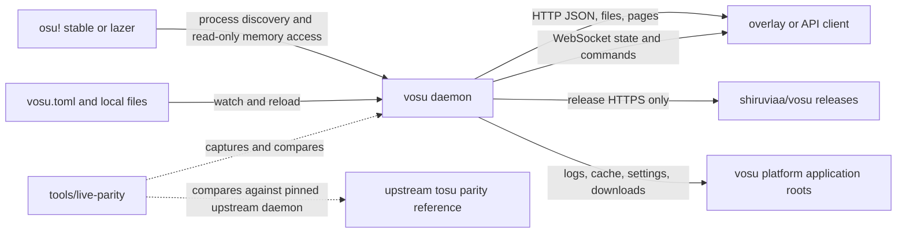
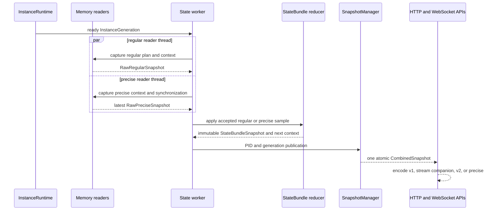

# Architecture

This document is a maintainer map for the current Rust implementation of **vosu**. It describes ownership and runtime boundaries rather than duplicating user-facing setup or endpoint reference material. Architectural decisions are indexed in [decisions](../decisions/index.md); performance observations belong in [benchmarks](../testing/benchmarks.md).

[Runtime and configuration workflows](../workflows/runtime-and-config.md) cover startup, reload, listener replacement, and shutdown. [Compatibility and calculation workflows](../workflows/compatibility-and-calculation.md) cover public projections and the two calculation contracts.

## Goals and constraints

The daemon discovers running osu! clients, reads their memory without modifying them, reduces samples into coherent immutable state, and publishes compatible HTTP and WebSocket schemas. The implementation must preserve four vosu API surfaces—v1, stream companion, v2, and v2 precise—while supporting multiple client processes and both stable and lazer memory layouts.

Important constraints visible in the code are:

- Linux and Windows have different process, memory, path, focus, and update implementations; platform selection is compile-time (`src/process/{linux,windows}.rs`, `src/platform/{linux,windows}.rs`, `src/updater/platform.rs`).
- Remote reads are fallible and may race the target process. Decoding distinguishes ready, pending/unchanged, unsupported, corrupt, and failed data instead of treating every failure as an empty value (`src/process.rs::ReadStatus`, `src/memory.rs::MemoryReader`).
- Regular and precise sampling have independent configured cadences, but all state transitions are serialized before publication (`src/state/worker.rs::spawn_state_worker_with_clock`).
- Public payloads must represent one atomic state point; wire schemas never assemble independently loaded pieces (`src/api.rs`, `src/api/snapshot.rs::SnapshotManager`).
- Calculation compatibility has two contracts: state-driven live calculation uses the dedicated calculator crate, while the calculation endpoint follows the legacy rosu-pp-js-compatible builder (`src/calculation/engine.rs`).

## System context



The daemon boundary is the `vosu` process; hosted tools are supervised out-of-process applications behind its HTTP contract. osu! is an observed external process; consumers, including independent overlay software, release services, and the local filesystem are external dependencies. [ADR 0008](../decisions/0008-external-in-game-overlays.md) keeps in-game overlay UI and state outside this boundary. `tools/live-parity/run.py` is not a production container: it orchestrates deterministic upstream-tosu-versus-vosu captures for the supported Windows/stable, Windows/lazer, and Linux/lazer matrix declared in `tools/live-parity/live_parity.py`.

## Containers and ownership

```mermaid
flowchart TB
    Entry[src/main.rs] --> Runtime[src/runtime/lifecycle.rs<br/>ProductionRuntime]
    Runtime --> Config[src/config<br/>ConfigStore]
    Runtime --> Instances[src/instance.rs<br/>InstanceRuntime and InstanceManager]
    Instances --> Process[src/process.rs and src/process/*<br/>ProcessHandle and ProcessMemory]
    Process --> Readers[src/memory/*<br/>stable and lazer readers]
    Runtime --> Supervisor[src/runtime/worker.rs<br/>ProductionStateSupervisor]
    Readers --> Workers[src/state/worker.rs<br/>regular and precise capture]
    Workers --> Reducer[src/state/bundle/*<br/>StateBundle]
    Reducer --> Snapshot[src/api/snapshot.rs<br/>SnapshotManager]
    Snapshot --> Schemas[src/api/{v1,v2,precise,sc}.rs]
    Schemas --> Server[src/server/*<br/>Axum HTTP and WebSocket]
    Reducer --> Calc[src/calculation/* and<br/>crates/vosu-pp]
    Config --> Runtime
    Runtime --> Update[src/updater/*]
    Runtime --> Desktop[src/desktop/*<br/>tray and login service]
```

`src/main.rs` only constructs Tokio, calls `runtime::run_cli`, maps the startup-owner conflict to exit status 75, and bounds runtime shutdown. `src/runtime/lifecycle.rs::ProductionRuntime` is the composition root and owns every long-lived service: configuration, logging, authorization, listener, WebSocket hubs, command processor and relays, counters, instance runtime, state supervisor, update handoff, and shutdown token. Its shutdown order first stops new HTTP accepts, closes WebSockets, then joins downstream services before configuration and logging.

`src/desktop/login.rs` owns the opt-in Linux graphical-session user unit, independently of daemon startup and settings persistence. It injects the existing `PathResolver` and a `CommandRunner`, writes only a vosu-marked unit, and invokes `systemctl --user` without a shell or `--now`. Runtime composition treats startup reconciliation errors as warnings; settings save must reconcile before publishing or persisting `START_AT_LOGIN`.

Offset resolution is part of each discovered lazer instance lifecycle.
`src/runtime/offset_generator.rs` receives the exact PID and version. The loader
first accepts a valid exact-instance cache entry, then matching embedded offsets,
then invokes the embedded self-contained generator against that same PID. The
generator returns bytes; the loader validates them and atomically installs the
versioned offsets cache entry.

The platform-matching generator ZIP and checksum are embedded in release
binaries. On first use, the daemon extracts the payload into the normal
`offset-generator` cache and reuses it only when its embedded checksum matches.
The offsets cache remains the validated versioned `<version>.json` contract;
bundle identity does not become offset-file metadata. No remote offset source,
local-source environment override, or global process scan is involved.
The generator uses no user-installed .NET runtime. Release builds require the
payload; a debug/development build without one reports an explicit
missing-bundle error. Maintainer preparation uses the .NET SDK and
`scripts/prepare-offset-generator.py`; generated binaries are not source inputs.

`src/runtime/offset_generator/client_runtime.rs` stages the helper entry points
with the exact client's self-contained runtime pack and runtime configuration.
It replaces the helper's build-runtime dependency entry with the client's
managed/native runtime manifest, including NuGet framework replacements and
their transitive dependencies. Game application assemblies stay in the target's
isolated load context. Framework-version upgrades therefore require neither
an end-user SDK nor offsets measured under a different CLR. Entry points
and host libraries use hard links or copies rather than symlinks: the .NET host
canonicalizes the entry assembly path, and a symlink would select the original
bundle's runtime. Linux links the remaining runtime files; Windows hard-links
or copies them. Staging is generation-local and removed afterward; the
checksum-verified payload and game installation remain untouched.

### Ownership map

| Concern | Primary ownership | Main entry points |
|---|---|---|
| Startup and process-wide lifecycle | `src/app.rs`, `src/runtime/lifecycle.rs` | `App::run`, `run_cli`, `ProductionRuntime::compose` |
| Client discovery, generations, focus | `src/instance.rs`, `src/instance/discovery.rs` | `InstanceRuntime`, `InstanceManager`, `classify_candidates` |
| Native process access | `src/process.rs`, `src/process/linux.rs`, `src/process/windows.rs` | `ProcessMemory`, `ProcessHandle`, platform backends |
| Signature/offset scanning | `src/process/scanner.rs`, `src/memory/stable/signatures.rs`, `src/memory/lazer_{loader,offsets,version}.rs` | `Pattern`, `StablePatterns`, `LazerOffsetLoader` |
| Raw client decoding | `src/memory/stable/*`, `src/memory/lazer/*`, `src/memory/snapshot/*` | `MemoryReader`, `StableMemory`, `LazerMemory`, raw snapshots |
| Capture scheduling and state transitions | `src/state/worker.rs`, `src/state/readers.rs`, `src/state/bundle/*` | `spawn_state_worker`, `StateBundle`, `SnapshotTransition` |
| Multi-instance publication and focus selection | `src/runtime/worker.rs`, `src/api/snapshot.rs` | `ProductionStateSupervisor`, `publish_manager_snapshot`, `SnapshotManager` |
| Public schema construction | `src/api/v1.rs`, `src/api/v2.rs`, `src/api/precise.rs`, `src/api/sc.rs` | schema `build`/`encode` functions, `ProductionSnapshotEncoder` |
| HTTP routing and authorization | `src/server/routes.rs`, `src/server/auth.rs`, `src/server/service/*` | `Endpoint`, `RouteProviders`, `ProductionRouteDelegate` |
| WebSocket publication, subscriptions, and commands | `src/server/websocket.rs`, `src/server/v2_subscription.rs`, `src/server/commands.rs`, `src/runtime/worker.rs` | `WebSocketHub`, `V2SubscriptionHub`, `CommandProcessor`, `WebSocketHubs` |
| Listener bind/reload/drain | `src/server/runtime.rs` | `ListenerRuntime`, `AxumListenerFactory`, `ListenerOwner` |
| Live and endpoint calculation | `src/calculation/*`, `crates/vosu-pp/src/lib.rs` | `LiveStateCalculationBackend`, `LiveBeatmapEngine`, `LegacyRosuEngine` |
| Filesystem and platform paths | `src/platform.rs`, `src/server/files.rs` | `Paths`, `safe_child`, `resolve_resource` |
| Configuration | `src/config/*` | `ConfigStore`, `ConfigDocument`, `ConfigSchema` |
| Desktop integration | `src/desktop/*` | session tray, executable ownership policy, Linux `login::reconcile` |
| Self-update | `src/updater/*` | startup recovery, release validation, prepare/transaction/platform stages |
| Hosted tools | `src/tools/{mod,manifest,process,http,bundled}.rs` | `ToolHost`, manifest validation, supervised children, proxy/session authorization, embedded bundle materialization |
| Live compatibility validation | `tools/live-parity/*` | `run.py`, `parity_capture.py`, `parity_compare.py`, `parity_diff.py` |

## Runtime data flow



### Discovery and reader boundary

`InstanceRuntime` repeatedly asks `NativeProcessProvider` for candidates. `src/instance/discovery.rs::classify_candidates` performs platform-specific classification; Linux uses a named first pass before its broader lazer fallback. On Windows, discovery caches bitness and command-line metadata by PID, but invalidates that entry when `GetProcessTimes` reports a new creation time, so PID reuse cannot inherit stale instance arguments or roots. `InstanceManager` validates and opens candidates, assigns a monotonically increasing generation, removes dead processes, and deterministically selects tournament manager first or otherwise the lowest matching PID. A reused PID therefore becomes a new generation rather than mutating an existing worker.

`src/process.rs::ProcessMemory` is the object-safe syscall boundary. Platform backends own native handles and must either fill every requested destination or return an error. `ProcessHandle` adds pointer-width-aware primitive, managed collection, batch, liveness, and module operations above that boundary. Stable signature discovery and lazer offset resolution stay outside the OS backend. Each lazer generation starts at most one lifecycle-owned offset resolver and is not eligible for a state worker until immutable offsets are installed; stable generations are ready immediately (`Instance::start_lazer_resolver`, `ProductionStateSupervisor::run_state_supervisor`).

`src/memory.rs::MemoryReader` is the client-decoding boundary. Stable and lazer implementations translate client-specific pointers and sentinels into typed raw snapshots and `ReadStatus`. Regular and precise reader instances are independent because their blocking capture threads cannot share mutable pointer caches. `ReaderSynchronization` copies only the small address state needed by lazer precise capture; stable leaves it empty.

### Regular and precise state

`src/state/worker.rs` owns two named blocking reader threads plus one async reducer task per ready process generation. The regular path is backpressured by a one-slot permit channel, so only the requested capture plan is produced. The precise path overwrites a latest-only slot; it does not queue every high-frequency observation. The reducer gives regular input priority, rejects samples whose source, generation, sequence, mode/mod context, or hit-error suffix is stale, then calls `StateBundle::apply_regular` or `StateBundle::apply_precise` serially.

While `V2SubscriptionHub::demand` reports an established selection, both readers sleep `min(V2_SUBSCRIPTION_DEBOUNCE, own interval)` (`PollIntervals::{regular_delay,precise_delay}`). The regular reader tags a capture `RegularCaptureContext::api_cadence` only when at least `POLL_RATE` has passed since the previous tagged capture; the reducer applies the same rule to precise publications against `PRECISE_DATA_POLL_RATE`. Each publication carries a `Delivery` (`All`, `Precise`, or `Live`). The stable stall-pause heuristic compares against the last API-cadence play time, so faster sampling cannot report a pause that did not happen; untagged samples may resume but never assert a pause.

The reducer in `src/state/bundle/reducer.rs` applies raw values, retention rules, status transitions, beatmap/gameplay calculation updates, and derives the next read context/capture plan. It emits an immutable `StateBundleSnapshot`. `StatePublicationSink` derives two states per publication: the live state and the API state, which keeps the regular component of the last API-cadence capture (`api_state`). A generation or reset-epoch change goes to API readers at once, so a regular transition and the precise reset it causes stay atomic. `ProductionStateSupervisor` accepts worker publications through a per-PID latest-only slot that carries both states, rejects any PID generation that is no longer desired, and keeps one `ManagerView` per target. It publishes API managers through `SnapshotProviders::publish_api` and live managers through `SnapshotProviders::publish_live`; each target has its own semantic revisions.

Hit-error reads and appends require an authoritative precise `Play` status rather than a stale regular-context fallback. The first-object/150-ms timing guards do not suppress hit errors or reset their history. A native list rewind updates the acknowledged cursor without erasing accumulated `all`, `press`, or `release` events or their totals. Pause/results retain history; map exit and a genuine retry reset the attempt through the regular lifecycle/epoch boundary.

Regular and precise notifications remain independent. `src/runtime/projection.rs::SnapshotProviders::publish_api` wakes precise consumers for every atomic replacement but does not wake regular consumers for a precise-only replacement. Four compatibility hubs—v1, stream companion, v2, and v2 precise—use their configured poll cadence. The dedicated selected-field v2 hub consumes the separate live snapshot and its notifications, then applies its per-client debounce (`src/runtime/worker.rs::WebSocketHubs`). HTTP always loads the latest API snapshot on request.

### API and server publication

`src/api/snapshot.rs` owns immutable manager/combined snapshots and per-snapshot encoding caches. `src/api/{v1,sc,v2,precise}.rs` own wire construction; `src/runtime/projection.rs::ProductionSnapshotEncoder` is the filtered WebSocket bridge. `src/server/service/providers.rs::SnapshotStateProvider` serves HTTP encodings from the same atomic snapshot and its `OnceLock` caches. No route reads game memory directly.

`src/server/routes.rs` classifies exact methods and paths into typed `Endpoint` values, enforces authorization and request-body limits, and delegates state, calculation, files/pages, counters, settings, reports, updates, and WebSocket upgrades through narrow provider traits. `src/server/runtime.rs::ListenerRuntime` resolves and binds desired targets, retains the old effective listener if replacement resolution/bind fails, and drains superseded listeners. `ListenerOwner::start` does not report readiness until the initial address is actually bound.

`auth::MutationAuthorization` separates exact same-origin mutation intent from the overlay-compatible read policy. Dispatch enforces it before every management POST and captures it in request extensions for WebSocket upgrades. The production socket transport permits read/settings/filter commands on untrusted-origin sockets, but closes them before any state-changing command reaches `CommandProcessor`. This preserves stock hosted counter writes and non-hosted reads without adding a handshake token.

`src/server/origins.rs` separates trusted dashboard pages/management from the unchanged overlay origin ([ADR 0016](../decisions/0016-separate-dashboard-origin.md)). Each listener has an explicit origin role and shares effective address metadata. Dashboard mutations require exact dashboard provenance plus a per-start CSRF token; dashboard HTML is not CORS-readable, and overlay static files never run on that listener. Overlay command-socket settings and scoped key grants retain their compatibility contracts. This browser-origin boundary does not authenticate against malicious native same-account clients.

`src/tools` reserves `/tools` before counter static routing. `ToolHost` discovers development, embedded-bundled, and user tools, persists trust/enabled state and settings in a separate config namespace, and owns bounded service logs and supervised child lifetimes. Services receive per-launch secrets, bind ephemeral loopback ports, and pass readiness/health checks before requests are forwarded. Public read prefixes remain overlay-readable; mutations require a dashboard-minted tab session or a declared dependent tool token. Dashboard-only `/api/tools` management retains provenance and CSRF checks. Shutdown closes child stdin and enforces a five-second exit bound; Linux parent-death signals and Windows kill-on-close jobs additionally contain daemon death. See the [tool protocol](../tools/protocol.md).


Compatibility WebSocket connection ownership lives in `src/server/websocket.rs::WebSocketHub`; selected-field v2 subscriptions use the separate `src/server/v2_subscription.rs::V2SubscriptionHub`. Publication tasks live in `WebSocketHubs`. Both hub types bound each client to one pending state frame and shutdown seals registration and sends protocol close 1001 before cancelling publication loops. Commands are parsed and dispatched by `src/server/commands.rs::CommandProcessor`; relay lifecycle remains separate in `src/server/service/relay.rs`, and the selected-field endpoint does not register a command or relay client.

State delivery retains its one-frame latest-state bound. Compatibility control queues and the shared relay mailbox each have capacity 16; relay producers use nonblocking admission, and shared delivery never waits for a recipient mutex/control queue. Saturated recipients are cleaned up without stalling healthy recipients. Legacy filter parsing caps input nodes/depth and deduplicates the resulting projection.

### Calculation path

There are two intentional paths:

1. **Live state calculation.** Regular state transitions build requests in `src/state/bundle/calculation.rs`. `src/calculation/state_backend.rs::LiveStateCalculationBackend` resolves beatmap readiness, parsing/cache state, gameplay/result progression, and runs blocking work outside the async reducer. `LiveBeatmapEngine` delegates difficulty, strains, and performance to the `crates/vosu-pp` Rust facade, whose `rosu-map-api` and `rosu-pp-api` workspace members preserve pinned upstream evidence and licensing boundaries. Results return to the reducer only when their state key and calculation generation are still current.
2. **Calculation endpoint.** `src/server/service/providers.rs::LegacyCalculateProvider` selects either the current beatmap or a canonical regular `.osu` file supplied by the query, maps the request, and invokes `src/calculation/engine.rs::LegacyRosuEngine`. This preserves the legacy rosu-pp-js-compatible setter order and must not be silently routed through the live calculator contract.

Beatmap parsing, timing/events, object graphs, and cache ownership are under `src/calculation/beatmap/*`; progressive gameplay/result state is under `src/calculation/progressive/*`.

## Configuration, files, and updates

`ConfigStore` treats the platform config root's `vosu.toml` as the canonical flat, typed TOML document with uppercase binding names. Initialization layers defaults, `tosu.env`, `vosu.env`, and then canonical TOML, giving precedence `vosu.toml > vosu.env > tosu.env > defaults`; the dotenv files are migration inputs only. It writes the merged canonical bytes to a same-directory temporary file, flushes and syncs them, atomically replaces `vosu.toml`, and only then removes readable legacy inputs. Malformed canonical TOML fails startup before any write or removal. The parent-directory watcher reacts to create/modify events for the canonical path, parses complete valid documents, and leaves the last-good `Arc<Config>` published when a reload is malformed. Programmatic updates publish immediately and schedule a debounced atomic save. `register_before_publish` is a barrier for resources such as the static root that must be replaced before matching configuration becomes observable. Runtime reload handling lives in `src/runtime/config.rs`; authorization and listener targets are reloadable rather than process globals.

`src/platform.rs::Paths` resolves program, launch, config, data, and cache roots and creates the latter three. On Linux, startup performs an idempotent one-time move from former `tosu` XDG roots to `vosu` roots without replacing already-current state. Default static content is under the data root; custom relative static paths are relative to the launch directory. `src/server/files.rs` owns percent decoding, containment checks, platform-secure opens, directory indexes, media ranges, and content types. Invalid, malformed, and escaping public paths collapse to not-found rather than exposing host filesystem details.

`ReloadableCounterService` replaces only root-specific filesystem selection on reload. Install admission (four jobs), the install gate, cancellation and active-job join accounting remain shared across all generations; detached jobs remain shutdown-owned after HTTP cancellation. No retired-generation registry is needed.

`src/updater.rs` and its `release`, `prepare`, `transaction`, `startup`, `helper`, and `platform` modules form a crash-recoverable transactional, single-flight update boundary. Release validation precedes preparation; a durable `.vosu-update.json` install record drives candidate/rollback recovery on the next start. Update handoff is owned by the application lifecycle so the listener and other services shut down before replacement. Release archive entry and expanded-byte limits are enforced in this boundary.

Candidate/rollback readiness uses a one-use secret delivered only through the exact child's piped stdin, not process-visible arguments or the durable record. The public transaction token still selects the transaction but cannot substitute for that readiness secret.

## Deployment variants

- The workspace builds one `vosu` binary, the internal `vosu-pp` facade plus its `rosu-map-api` and `rosu-pp-api` members, and `vosu-test-harness`; the harness is test support, not a production process (`Cargo.toml`).
- Windows supports stable and lazer discovery/memory access. Linux supports native lazer and stable through Wine. For Wine installs, `src/process/linux.rs::resolve_osu_path` resolves the game root from `VOSU_OSU_PATH`, `${XDG_DATA_HOME:-$HOME/.local/share}/osuconfig/osupath`, or the target command line. The formal `tools/live-parity/live_parity.py::SUPPORTED_MATRIX` currently lists Linux/lazer but not Linux/stable; that tooling matrix is narrower than runtime support.
- Native backends are selected with `cfg(windows)` and `cfg(target_os = "linux")`; there is no generic production process provider for other operating systems.
- Release builds use thin LTO, one codegen unit, stripped symbols, and abort-on-panic (`Cargo.toml`). Panic therefore terminates the daemon rather than unwinding production resources.

## Concurrency and failure behavior

- Process generations own cancellation tokens. Resolver tasks and state workers are cancelled and joined before their generation is released; the supervisor aborts only after its bounded shutdown wait.
- Blocking memory capture and live-state calculation run outside Tokio worker threads. The legacy calculation endpoint currently calls `LegacyRosuEngine` synchronously from its request provider. The binary bounds Tokio shutdown because an already-running `spawn_blocking` live calculation cannot be aborted.
- Configuration persistence/reload and ordered console/file writing each have one blocking owner. Counter-page discovery admits at most two blocking scans at once; report generation has a separate single-operation admission gate and bounded retained log content. Admission happens before spawning; cancellation does not free a running worker's slot prematurely.
- V1/V2 encoders borrow large graph/hit-error vectors through defaulted generic DTO storage, while public owned builders retain `Vec` defaults and the same wire schema. Precise encoding also borrows arrays, and V2 encoding uses the existing serialized graph cache without cloning its backing vectors.
- Live full-map and progressive calculations share prepared immutable map storage and full difficulty/maximum-score results. Stable mania replay snapshots share retained frame backing across unchanged polls; append/acknowledgement/rewind/score replacement preserve reset semantics.
- Latest-only precise capture, per-PID worker-to-supervisor publication slots, and atomic snapshots bound queue growth and prevent mixed publications. A late publication from an older process generation cannot replace a newer pending generation.
- Read errors are retained/reported according to method-specific policies in `src/memory.rs::ErrorReportCounters`; transient target races need not erase last-good state. Corrupt lengths and address arithmetic fail explicitly at the process boundary.
- A failed listener reload leaves the previous listener effective. Listener shutdown stops accepts, waits up to `src/server/runtime.rs::DRAIN_TIMEOUT`, then cancels survivors.
- Configuration, logging, startup recovery, initial binding, and required embedded offsets can fail startup. A quarantined update recovery is logged and startup continues; active-owner conflicts receive the dedicated exit status.
- Shutdown is dependency ordered in `ProductionRuntime::shutdown`, and WebSockets close before their backing snapshot provider can be dropped.

## Quality risks and change hotspots

1. **Compatibility drift.** Four schemas, two calculator contracts, and stable/lazer sentinel behavior are intentionally distinct. Changes should start at the owning builder/reader, then be checked with targeted compatibility tests rather than normalized in a shared convenience layer. `tools/live-parity` is an optional diagnostic for suspected upstream divergence.
2. **Target-process races.** Addresses can become stale between discovery and reads. Keep native reads all-or-error, validate lengths/addresses, preserve generation and context checks, and never move decoding into platform syscall code.
3. **High-frequency work.** Precise polling can be much faster than regular polling. Avoid allocations, blocking Tokio tasks, or unbounded fan-out on `MemoryReader`, reducer, projection, and WebSocket hot paths. Use the measured evidence in [benchmarks](../testing/benchmarks.md), not assumed throughput.
4. **Atomicity regressions.** Loading focus, regular state, precise state, or configuration independently in a wire builder can expose impossible combinations. Extend `ManagerSnapshot`/`CombinedSnapshot` and publish once instead.
5. **Calculator revision coupling.** `vosu-pp` records exact `rosu-pp`, `rosu-map`, and osu! framework revisions in workspace metadata and provenance inputs. Upgrading those sources or sharing the legacy endpoint engine with live calculation changes observable results and requires an explicit decision record.
6. **Filesystem and updater safety.** Path containment, canonicalization, atomic replacement, durable install phases, and startup recovery are security/reliability boundaries. Do not bypass them from route handlers or ad-hoc update code.
7. **Platform asymmetry.** Focus, module enumeration, process opening, secure file opening, paths, and executable replacement differ by OS. A change verified on one backend is not evidence for the other.
8. **Abort-on-panic.** Release panic strategy makes unchecked assumptions process-fatal. Treat `expect` sites on runtime data and poisoned synchronization recovery as architecture-sensitive.

When a change alters one of these boundaries, record why in [design decisions](../decisions/index.md); when it claims a hot-path improvement, attach machine-specific evidence in [benchmarks](../testing/benchmarks.md).

For a directory-level ownership view, see the [source map](source-map.md).
