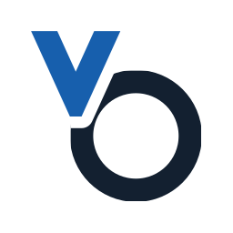

# vosu branding

vosu is an 18-LAB product (stage code 18-01). Its art follows the [18-LAB design system](tools/design.md) and sits beside vosulay's and the first-party tools' art as one family. The terms are in the "Branding assets" section of [`LICENSE`](../LICENSE).

## Mark



The signal V, vosu's mark since 1.0, in 18-LAB colours: a telemetry line runs in, dips into a V and holds a signal node at its vertex. vosulay's mark puts the same V inside an overlay-layout frame.

- Geometry (original coordinates): the line `M18 36 H32 L64 94 L96 36 H110`, 12-unit stroke, round caps and joins; the node is a 5.5-unit dot at (64, 94) with the line cut 10 units around it.
- Never recolour beyond the roles below, outline, rotate, add effects, or drop the node or the lead-in lines.
- 16 and 24 px have their own pixel-fitted masters (`vosu-app-icon-16.svg`, `vosu-app-icon-24.svg`) with 2- and 3-pixel lines. Use them for tray, favicon and small taskbar icons; everything from 32 px up scales the master.

| Role | Light (DRAFTING) | Dark (WORKSTATION) |
| --- | --- | --- |
| V (accent) | `#175fad` | `#ff963f` |
| Node (signal) | `#b8621b` | `#7fa6cf` |
| Wordmark | `#132030` | `#ebe8e1` |
| Rule, endorsement | `#a7b2bd`, `#3b4858` | `#3b3f45`, `#b8b5ad` |

The app icon puts the mark on a graphite (`#111214`) tile with 12 % corner radius, at the 1.x icon's size and position. The dashboard and report pages draw the mark inline with `--accent` and `--signal`, so it follows the page's mode.

## Lockup

`vosu-logo.svg` (light surfaces) and `vosu-logo-on-dark.svg`: the mark and the monoline lowercase vosu wordmark from 1.x, a hairline rule, and the 18-LAB logotype as endorsement in one ink colour. The 18-LAB logotype's mark stands in for "18"; never set a typed "18" beside it. Keep clear space of one node gap (10 units) around the lockup. Use it at 64 px height or more, where the endorsement stays legible; smaller, use the mark alone. The dashboard header is the same lockup in live type.

## Files

| File | Use |
| --- | --- |
| `vosu-app-icon.svg` | Master app icon; Linux `hicolor/scalable` |
| `vosu-app-icon-16.svg`, `vosu-app-icon-24.svg` | Pixel-fitted small masters |
| `vosu-mark.svg` | Mark without tile, follows `prefers-color-scheme` |
| `vosu-logo.svg`, `vosu-logo-on-dark.svg` | Lockup |
| `vosu-banner.svg`, `vosu-banner-light.svg` | README header, 1280×320, chosen with `<picture>` |
| `vosu-social-preview.svg` / `.png` | GitHub repository social preview, 1280×640; upload the PNG in the repository settings |
| `icons/vosu-<size>.png` | 16–512 px: Linux tray pixmaps (16–64) and `hicolor` package icons |
| `../icon.ico` | Windows executable, taskbar and tray icon: 16, 20, 24, 32, 40, 48, 64, 128 (DIB) and 256 (PNG) |
| `../server/favicon.ico` | Dashboard favicon: 16, 32, 48 |

## Rendering

The SVG files are the source; every raster is generated and committed, so builds and packages need no image tools. After changing a master:

```sh
python scripts/render-brand.py           # needs resvg on PATH (0.48)
python scripts/render-brand.py --check   # committed rasters match the masters
python scripts/check-asset-hashes.py --write
```

Text in the banners and social preview, and the 18-LAB logotype, is outlined, so they render the same on GitHub and in image viewers without fonts. It was set in Barlow Condensed 600, Barlow 400 and IBM Plex Mono 500 from `assets/server/` (HarfBuzz shaping, glyph outlines via fontTools). To change a line, outline the new text from the same fonts, keep the sizes and positions, and re-render.
